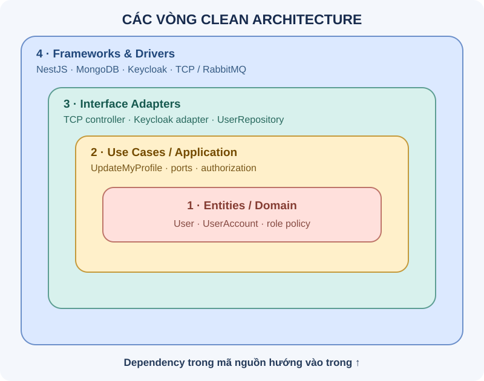
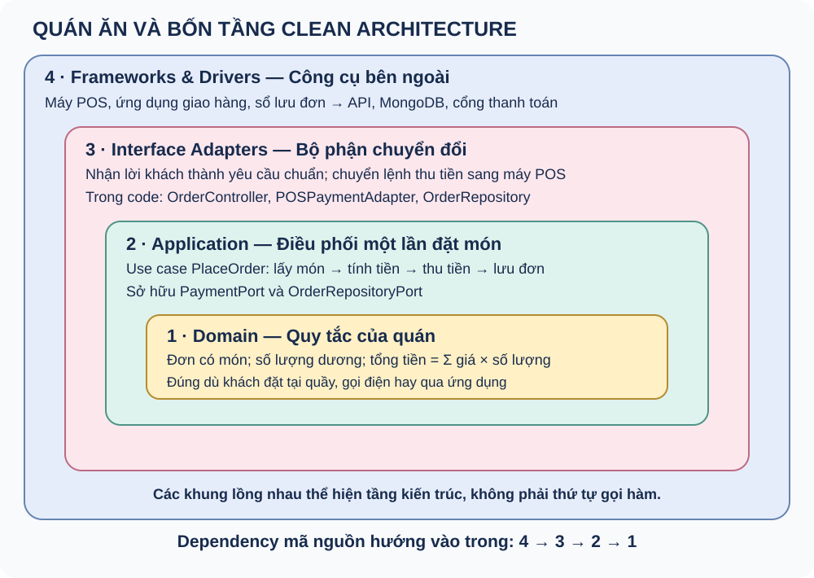
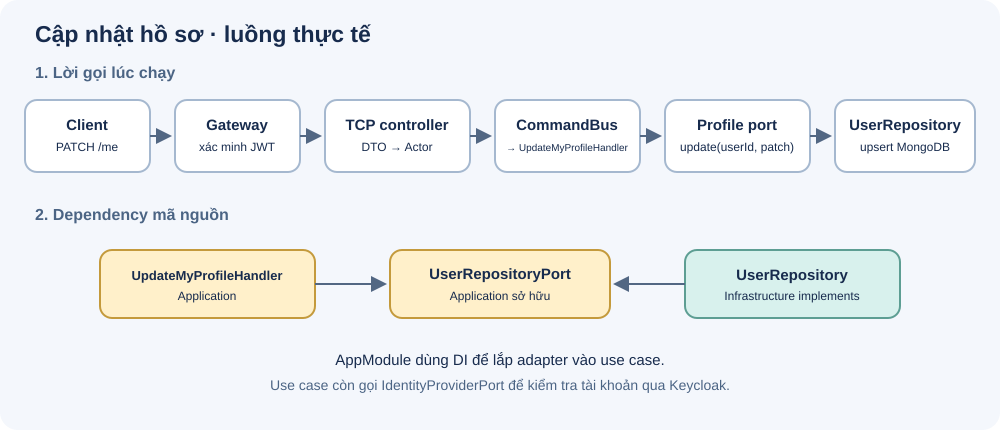
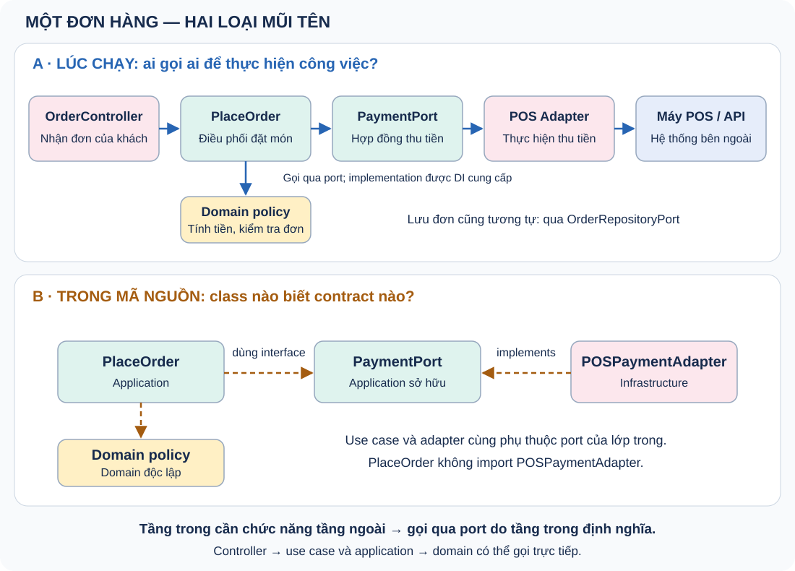

> Tài liệu lịch sử: các nội dung về phân quyền và quản lý role không còn phản ánh implementation hiện tại. Các thao tác quản lý tài khoản đang tạm bị từ chối.

# Clean Architecture — học, ôn tập và phỏng vấn

Ví dụ xuyên suốt là thiết kế và code **w-identity** đã có kiểm thử; đây chưa phải bằng chứng vận hành production. Xem [PLAN.md](./PLAN.md).

Học theo thứ tự 0–13. Mỗi ngày đọc hai chủ đề, tự nói câu trả lời trong 60–90 giây rồi luyện thẻ câu hỏi. Cuối tuần làm bài thực hành và một buổi phỏng vấn giả lập 20 phút. Trạng thái 📖 là tài liệu lý thuyết, không khẳng định bạn đã học thuộc.

## Bảng tiến độ

| # | Chủ đề | Bước PLAN | Trạng thái |
|---|---|---|---|
| 0 | Clean Architecture trong 60 giây | Clean Architecture | 📖 |
| 1 | Dependency Rule và luồng thực thi | Clean Architecture | 📖 |
| 2 | Domain: mô hình và quy tắc | Clean Architecture | 📖 |
| 3 | Application và use case | Clean Architecture | 📖 |
| 4 | Ports, adapters và quyền sở hữu interface | Clean Architecture | 📖 |
| 5 | DIP, DI và composition root | Clean Architecture | 📖 |
| 6 | DTO, mapper và ranh giới dữ liệu | Clean Architecture | 📖 |
| 7 | Validation và authorization nằm ở đâu | Clean Architecture | 📖 |
| 8 | Lỗi, timeout và kết quả chưa xác định | Clean Architecture | 📖 |
| 9 | Transaction và tính nhất quán giữa hai hệ thống | Clean Architecture | 📖 |
| 10 | Chiến lược kiểm thử | Clean Architecture | 📖 |
| 11 | Clean, Hexagonal, Onion và layered architecture | Clean Architecture | 📖 |
| 12 | Đánh đổi và khi nào áp dụng | Clean Architecture | 📖 |
| 13 | Bài thực hành và câu trả lời phỏng vấn | Clean Architecture | 📖 |

## 0. Clean Architecture trong 60 giây

Tách quy tắc nghiệp vụ khỏi chi tiết giao tiếp và lưu trữ để kiểm thử và thay đổi độc lập. Điều quyết định là hướng phụ thuộc trong mã nguồn, không phải số thư mục.

### Bốn vòng thường dùng, từ trong ra ngoài



Hình thể hiện các vòng khái niệm: càng vào trong càng gần nghiệp vụ. Tên thành phần trong hình là ví dụ tương ứng, không có nghĩa mỗi thư mục chỉ được chứa đúng một vòng.

| Vòng | Trách nhiệm | Ví dụ trong w-identity |
|---|---|---|
| **Entities / Domain** | Mô hình và quy tắc nghiệp vụ cốt lõi, độc lập với công nghệ. | `UserAccount`, `User`, `profile.policy.ts` và `DomainError` trong `domain/`. |
| **Use Cases / Application** | Điều phối hành động của ứng dụng, kiểm tra quyền và định nghĩa các port cần dùng. | `UpdateMyProfile`, `AuthorizationPolicy`, `UserRepositoryPort` trong `application/`. |
| **Interface Adapters** | Chuyển đổi dữ liệu giữa use case và thế giới bên ngoài; hiện thực các port. | TCP controller, DTO/filter trong `presentation/`; Keycloak adapter và MongoDB repository trong `infrastructure/`. |
| **Frameworks & Drivers** | Công cụ và hệ thống bên ngoài cung cấp giao tiếp, lưu trữ và vận hành. | NestJS, TCP/RabbitMQ, Mongoose/MongoDB, Keycloak. |

Đây là mô hình khái niệm: tên thư mục và số tầng triển khai có thể khác nhau. Trong dự án này, `presentation/` và `infrastructure/` đều chứa adapter; các file đó đồng thời dùng NestJS hoặc thư viện database. `AppModule` là **composition root** để lắp các thành phần, không phải một vòng nghiệp vụ riêng.

Quy tắc phụ thuộc: Domain không biết Application hay Infrastructure; Application biết Domain và port của mình; adapter bên ngoài biết Application/Domain. Ví dụ khi cập nhật hồ sơ, chiều gọi lúc chạy là controller → use case → repository → MongoDB, nhưng use case chỉ import port do Application sở hữu.

**Trả lời phỏng vấn:** “Bốn vòng là Entities, Use Cases, Interface Adapters và Frameworks & Drivers. Quy tắc chính là dependency mã nguồn hướng vào trong. Ở w-identity, UpdateMyProfile phụ thuộc UserRepositoryPort; UserRepository hiện thực port bằng MongoDB và AppModule lắp chúng lại.”

**Ví dụ w-identity:** Trong thiết kế w-identity, use case cập nhật hồ sơ dùng repository port; Mongoose nằm ở adapter bên ngoài.

**Bẫy phỏng vấn:** Chia đủ bốn folder nhưng application vẫn import Mongoose thì ranh giới chưa đúng.

**Tự trả lời:** viết lại bằng lời của bạn, nêu một đánh đổi và một tình huống kiểm thử.

### Ví dụ ngoài đời: quán ăn nhận đơn

Khách nói: **“Cho tôi hai phần cơm gà.”** Quán có thể nhận yêu cầu tại quầy, qua điện thoại hoặc qua ứng dụng giao hàng. Dù nhận qua đâu, đơn hàng vẫn phải tuân thủ quy tắc của quán.



| Tầng, từ ngoài vào trong | Vai trò trong quán | Ví dụ trong code |
|---|---|---|
| Frameworks & Drivers | Máy POS, ứng dụng giao hàng, sổ lưu đơn | API thanh toán, HTTP, database |
| Interface Adapters | Nhân viên chuyển lời khách thành thông tin chuẩn; bộ phận chuyển lệnh thu tiền sang POS | OrderController, POSPaymentAdapter, OrderRepository |
| Application / Use Cases | Người điều phối một lần đặt món | PlaceOrder lấy món, áp dụng quy tắc, thu tiền và lưu đơn |
| Domain | Quy tắc bán hàng của quán | Đơn có ít nhất một món; số lượng dương; tổng tiền bằng tổng giá nhân số lượng |

Đây là phép so sánh về **trách nhiệm**, không phải yêu cầu tạo một class cho mỗi nhân viên. Các quy tắc ví dụ vẫn đúng dù đổi kênh nhận đơn, máy POS hay database. Đó là phần cần được bảo vệ trong Domain. Application sắp xếp các bước để hoàn thành một yêu cầu cụ thể.

**Liên hệ w-identity:** controller nhận yêu cầu sửa profile; UpdateMyProfile điều phối; domain policy kiểm tra trạng thái tài khoản và dữ liệu profile; UserRepository thực hiện việc lưu thông qua contract UserRepositoryPort.

## 1. Dependency Rule và luồng thực thi

Dependency trong mã nguồn hướng về phần nghiệp vụ bên trong. Luồng chạy có thể đi từ use case ra adapter qua interface do lớp trong sở hữu.



Mũi tên hàng trên mô tả **lời gọi lúc chạy**. Mũi tên hàng dưới mô tả **dependency mã nguồn**: use case và repository cùng phụ thuộc port của Application. `AppModule` lắp repository vào use case khi khởi động.

**Ví dụ w-identity:** Application định nghĩa `IdentityProviderPort` và `UserRepositoryPort`; `KeycloakIdentityAdapter` và `UserRepository` implements các port tương ứng. Khi chạy, use case gọi adapter được truyền vào constructor. Trong mã nguồn, cả use case và adapter đều import port thuộc Application; Application không import repository cụ thể, kể cả bằng `import type`.

**Bẫy phỏng vấn:** Nhầm chiều gọi hàm với chiều import; nghĩ use case không được gọi database thông qua port.

**Tự trả lời:** viết lại bằng lời của bạn, nêu một đánh đổi và một tình huống kiểm thử.

### Theo dấu đơn cơm: gọi ra ngoài qua port



1. **OrderController nhận đơn:** chuyển “hai phần cơm gà” thành mã món và số lượng.
2. **PlaceOrder điều phối:** lấy thông tin món, gọi Domain kiểm tra đơn và tính tổng tiền.
3. **Use case yêu cầu thu tiền:** gọi PaymentPort với số tiền và mã đơn. Port này do Application định nghĩa.
4. **Adapter thực hiện:** POSPaymentAdapter implements PaymentPort, chuyển yêu cầu sang API của máy POS và trả kết quả.
5. **Use case yêu cầu lưu:** gọi OrderRepositoryPort; adapter lưu đơn bằng database.

Giả sử máy POS được đổi sang ví điện tử: thêm adapter thực hiện cùng PaymentPort và đổi wiring ở composition root. Quy tắc tính tiền và use case vẫn dùng contract cũ khi yêu cầu nghiệp vụ không đổi.

**Hai chiều phải phân biệt:**

- Lúc chạy: PlaceOrder gọi chức năng thanh toán do adapter bên ngoài thực hiện, thông qua PaymentPort.
- Trong mã nguồn: PlaceOrder import PaymentPort; POSPaymentAdapter cũng import và implements PaymentPort. Use case không import adapter cụ thể.

**Câu chốt để ôn:** Khi tầng trong cần chức năng do tầng ngoài cung cấp, nó gọi qua port do tầng trong định nghĩa. Tầng ngoài hiện thực port đó. Tầng ngoài gọi tầng trong, hoặc Application gọi Domain, có thể gọi trực tiếp; không cần tạo interface cho mọi lời gọi. Port có thể là interface, abstract class hoặc kiểu hàm.

**Tự kiểm tra:** Ai sở hữu PaymentPort? Đổi máy POS ảnh hưởng phần nào? Vì sao use case gọi adapter lúc chạy mà dependency mã nguồn vẫn hướng vào trong?

## 2. Domain: mô hình và quy tắc

Domain diễn tả khái niệm và bất biến nghiệp vụ. Entity không bắt buộc là class; có thể dùng kiểu dữ liệu và hàm thuần khi phù hợp.

**Ví dụ w-identity:** `User` mô tả hồ sơ; `assertActiveAccount` chặn tài khoản bị vô hiệu hóa đọc/sửa profile; `validateProfilePatch` kiểm tra locale, timezone, avatar URL và giới hạn field. Các policy là hàm thuần ở `domain/policies/profile.policy.ts`, chỉ dùng mô hình domain và `DomainError`.

`UpdateMyProfile` kiểm tra actor, lấy account qua port, gọi domain policy rồi mới ghi qua repository port. Vì use case tự gọi validation nên HTTP, TCP, RabbitMQ hoặc lời gọi trực tiếp đều chịu cùng quy tắc. DTO kiểm tra cấu trúc request và dùng lại validation domain; filter ánh xạ domain error thành response 400/403.

`UserPersistenceEntity` có decorator Mongoose nằm ở Infrastructure, ánh xạ collection `user_profiles`; nó khác với domain model `User`. Các model có thể giữ dạng interface khi chưa cần đóng gói hành vi trong class.

**Bẫy phỏng vấn:** Đưa mọi validation vào entity hoặc tạo class rỗng chỉ để gọi là DDD.

**Tự trả lời:** viết lại bằng lời của bạn, nêu một đánh đổi và một tình huống kiểm thử.

## 3. Application và use case

Use case mô tả một mục đích của người dùng, điều phối domain và ports, kiểm tra quyền và quyết định thứ tự thao tác.

**Ví dụ w-identity:** SetUserStatus kiểm tra admin, đổi trạng thái tài khoản rồi kết thúc session khi khóa.

**Bẫy phỏng vấn:** Tạo UserService khổng lồ hoặc để controller điều phối nhiều adapter.

**Tự trả lời:** viết lại bằng lời của bạn, nêu một đánh đổi và một tình huống kiểm thử.

### CQRS trong w-identity

Controller gửi message qua `CommandBus` hoặc `QueryBus`. Bus chỉ tìm handler; handler mới thực hiện use case. NestJS bus/decorator nằm ở `presentation/cqrs/`, còn command/query và logic handler thuần nằm ở `application/commands` và `application/queries`. Domain/Application không import `@nestjs/cqrs`.

| Command — thay đổi trạng thái hoặc tạo tác động bên ngoài | Query — đọc dữ liệu |
|---|---|
| CreateUserCommand, UpdateUserCommand | GetUserQuery |
| SetUserStatusCommand, SendPasswordResetEmailCommand | ListUsersQuery |
| UpdateMyProfileCommand | GetMeQuery |

Adapter có decorator NestJS kế thừa handler Application để cung cấp DI/đăng ký bus; không chứa business logic. Cùng một `UserRepositoryPort` phục vụ cả hai phía, với `findByUserId` và `update`; trách nhiệm đọc/ghi được giữ trong handler và kiểm thử.

`GetMeQuery` và `GetUserQuery` chỉ đọc. Nếu chưa có profile, trả `profile: null` và không tạo document. `UpdateMyProfileCommand` kiểm tra actor, domain policy rồi upsert profile ở lần cập nhật đầu tiên. OpenAPI đã mô tả profile nullable.

```text
TCP / RabbitMQ → Controller → CommandBus → Nest adapter → Application command handler
                           → QueryBus   → Nest adapter → Application query handler
                                                      ↓
                                                 Domain + ports
```

CQRS ở đây chạy đồng bộ trong worker, dùng chung database và connection pool hiện có. Event Sourcing, database đọc riêng và saga chưa được thêm. EventBus (nếu dùng sau này) phát sự kiện tới các handler; nó không tự trở thành use case hoặc hàng đợi RabbitMQ bền vững.

Tham khảo: [NestJS CQRS](https://docs.nestjs.com/recipes/cqrs).

## 4. Ports, adapters và quyền sở hữu interface

Port là hợp đồng lớp nghiệp vụ cần; adapter chuyển hợp đồng đó thành lời gọi công nghệ cụ thể. Interface nên nói bằng ngôn ngữ của bên sử dụng.

**Ví dụ w-identity:** `IdentityProviderPort` cung cấp `get`, `create`; `KeycloakIdentityAdapter` chuyển dữ liệu Keycloak sang `UserAccount`. `UserRepositoryPort` cung cấp `findByUserId(userId)` trả `User | null` và `update(userId, patch)` trả `User`; query và command dùng chung port này. Những khả năng CRUD kế thừa từ `MongoDBRepository` không nằm trong hợp đồng mà use case sử dụng.

**Bẫy phỏng vấn:** Định nghĩa port trả Keycloak SDK object khiến abstraction vẫn rò rỉ nhà cung cấp.

**Tự trả lời:** viết lại bằng lời của bạn, nêu một đánh đổi và một tình huống kiểm thử.

## 5. DIP, DI và composition root

DIP là nguyên tắc phụ thuộc vào abstraction; DI là cách cung cấp dependency từ ngoài. Composition root chọn implementation và lắp object graph. DI không tự bảo đảm DIP.

**Ví dụ w-identity:** Use case nhận port qua constructor thuần; factory trong `AppModule` truyền adapter vào. Interface TypeScript bị xóa khi chạy; Nest dùng symbol `USER_PROFILE_REPOSITORY` làm runtime token và `useExisting: UserRepository` để tái sử dụng instance đã được `DatabaseModule` khởi tạo. Constructor use case không cần decorator hoặc token NestJS.

**Bẫy phỏng vấn:** Inject Mongoose Model trực tiếp vào use case vẫn gắn use case với database dù đã dùng DI.

**Tự trả lời:** viết lại bằng lời của bạn, nêu một đánh đổi và một tình huống kiểm thử.

## 6. DTO, mapper và ranh giới dữ liệu

DTO giao tiếp, mô hình nội bộ và document lưu trữ có mục đích khác nhau. Mapper chỉ cần khi có ranh giới thật hoặc hình dạng khác nhau.

**Ví dụ w-identity:** GatewayRequest.user được chuyển thành Actor; MongoDB _id không xuất hiện trong response API.

**Bẫy phỏng vấn:** Trả nguyên document hoặc token Keycloak; ngược lại tạo mapper giống hệt ở mọi hàm gây dư thừa.

**Tự trả lời:** viết lại bằng lời của bạn, nêu một đánh đổi và một tình huống kiểm thử.

## 7. Validation và authorization nằm ở đâu

Presentation kiểm tra kiểu/định dạng dữ liệu; application kiểm tra quyền và điều phối; domain bảo vệ bất biến. Kiểm tra ở biên không thay thế kiểm tra nghiệp vụ.

**Ví dụ w-identity:** Gateway xác minh JWT; GetMe lấy ID từ actor, không nhận ID người khác trong body. Use case admin kiểm tra role trước khi gọi port.

**Bẫy phỏng vấn:** Chỉ dùng guard ở controller rồi nghĩ use case an toàn khi được gọi từ transport khác.

**Tự trả lời:** viết lại bằng lời của bạn, nêu một đánh đổi và một tình huống kiểm thử.

## 8. Lỗi, timeout và kết quả chưa xác định

Lỗi application có mã ổn định, không chứa HTTP/RPC exception. Adapter chuyển lỗi kỹ thuật; presentation ánh xạ ra giao thức. Timeout không chứng minh thao tác chưa xảy ra.

**Ví dụ w-identity:** Tạo user thành công nhưng gán role lỗi: trả thông tin user đã tạo. TCP filter chuyển sang GatewayRpcError; không tự tạo lại user.

**Bẫy phỏng vấn:** Catch mọi lỗi rồi trả 500; retry POST mù quáng có thể tạo tác dụng phụ trùng.

**Tự trả lời:** viết lại bằng lời của bạn, nêu một đánh đổi và một tình huống kiểm thử.

## 9. Transaction và tính nhất quán giữa hai hệ thống

Clean Architecture không cung cấp distributed transaction. Cần quyết định nguồn dữ liệu chuẩn, ranh giới ghi và chiến lược lỗi từng phần.

**Ví dụ w-identity:** Keycloak giữ tài khoản; MongoDB giữ hồ sơ tạo lười. Không cố dùng MongoDB transaction để rollback lời gọi Keycloak.

**Bẫy phỏng vấn:** Tưởng thêm repository là có atomicity giữa Keycloak và MongoDB. Outbox/saga chỉ thêm khi yêu cầu và hạ tầng phù hợp.

**Tự trả lời:** viết lại bằng lời của bạn, nêu một đánh đổi và một tình huống kiểm thử.

## 10. Chiến lược kiểm thử

Kiểm thử nghiệp vụ bằng fake ports; adapter bằng integration test; TCP mapping bằng controller test; các luồng chính bằng E2E. Thêm kiểm tra import để giữ ranh giới.

**Ví dụ w-identity:** `GetMeHandler` dùng fake object cho cả hai port, không khởi tạo repository thật hoặc Nest container. Test kiểm tra tài khoản bị khóa không chạm storage, lấy hồ sơ đúng ID và trả dữ liệu của port. Architecture test đọc AST TypeScript để chặn import/export sai lớp, gồm `import type`, re-export, dynamic import và `require`; kiểm tra cả unit test của core. Integration test riêng kiểm tra unique index và upsert đồng thời.

**Bẫy phỏng vấn:** Mock quá sâu từng lời gọi private; chỉ có fake test nên không phát hiện adapter sai hợp đồng.

**Tự trả lời:** viết lại bằng lời của bạn, nêu một đánh đổi và một tình huống kiểm thử.

## 11. Clean, Hexagonal, Onion và layered architecture

Các cách tiếp cận đều nhấn mạnh tách nghiệp vụ và chi tiết nhưng mô tả ranh giới khác nhau. Layered truyền thống có thể để service phụ thuộc implementation database; Clean dùng đảo phụ thuộc ở ranh giới đó.

**Ví dụ w-identity:** Cùng dịch vụ có thể giải thích theo ports/adapters hoặc các vòng domain/application. REST hay TCP không quyết định kiến trúc.

**Bẫy phỏng vấn:** Đồng nhất Clean Architecture với microservices, DDD hoặc bắt buộc CQRS. Monolith cũng áp dụng được.

**Tự trả lời:** viết lại bằng lời của bạn, nêu một đánh đổi và một tình huống kiểm thử.

## 12. Đánh đổi và khi nào áp dụng

Ranh giới thêm interface, mapping và chi phí điều hướng. Hữu ích khi nghiệp vụ phức tạp, nhiều tích hợp hoặc sống lâu; CRUD nhỏ có thể dùng cấu trúc nhẹ hơn.

**Ví dụ w-identity:** w-identity có Keycloak và MongoDB nên tách adapter có giá trị; giữ mọi lớp trong app thay vì tạo nhiều Nx libraries ngay.

**Bẫy phỏng vấn:** Hứa đổi database không tốn công: vẫn phải xử lý query, schema, migration và đặc tính consistency.

**Tự trả lời:** viết lại bằng lời của bạn, nêu một đánh đổi và một tình huống kiểm thử.

## 13. Bài thực hành và câu trả lời phỏng vấn

### Đọc code theo một luồng cụ thể

1. [IdentityController.profile](../src/presentation/tcp/identity.controller.ts) nhận message `identity.me.updateProfile`, chuyển body qua `profileBody` và danh tính qua `actorOf`.
2. Controller dispatch `UpdateMyProfileCommand` qua CommandBus; Nest adapter nhận lệnh và thực thi [UpdateMyProfileHandler](../src/application/commands/identity-command.handlers.ts) kiểm tra actor, dùng `IdentityProviderPort.get(actor.userId)` để xác nhận tài khoản còn hoạt động, rồi gọi `profiles.update(actor.userId, input)`.
3. [UserRepositoryPort](../src/application/ports/user-repository.port.ts) định nghĩa thao tác cần thiết bằng `ProfilePatch` và `User`; không chứa `Model`, query MongoDB hoặc decorator.
4. [UserRepository](../src/infrastructure/persistence/mongoose/user.repository.ts) implements port, thực hiện upsert, xử lý duplicate-key race và ánh xạ record thành `User`.
5. [AppModule](../src/app.module.ts) chọn adapter và lắp chúng vào use case. Đây là nơi biết cả port lẫn implementation.
6. [Unit test](../src/application/cqrs.spec.ts) truyền fake object chỉ có hai phương thức của port; [architecture test](../test/architecture.spec.ts) ngăn core phụ thuộc ngược ra ngoài.

Chiều phụ thuộc trong mã nguồn:

```text
Presentation ──→ Application ──→ Domain
Infrastructure ──→ Application ports + Domain models
AppModule ──→ các lớp cần lắp ghép
```

Luồng gọi khi chạy:

```text
Controller → CommandBus → UpdateMyProfileHandler → IdentityProviderPort → KeycloakIdentityAdapter
                            → UserRepositoryPort → UserRepository → MongoDB
```

Hai sơ đồ mô tả hai khía cạnh khác nhau: use case gọi ra database lúc chạy thông qua hợp đồng do Application sở hữu, trong khi dependency mã nguồn vẫn hướng vào trong.

### Câu trả lời mẫu 60–90 giây

“Trong w-identity, em tách Domain và Application khỏi NestJS, Keycloak và Mongoose. Với cập nhật hồ sơ, controller chuyển request thành input và Actor. Use case kiểm tra quyền, xác nhận tài khoản hoạt động qua IdentityProviderPort, rồi ghi hồ sơ qua UserRepositoryPort. Hai interface thuộc Application; adapter bên ngoài hiện thực chúng. AppModule chọn implementation và truyền vào constructor.

Em kiểm chứng bằng unit test dùng fake ports và architecture test chặn cả import type từ core ra Infrastructure. Điểm cần phân biệt là luồng gọi khi chạy có thể đi ra database, nhưng chiều phụ thuộc mã nguồn hướng vào hợp đồng bên trong. Đánh đổi là thêm interface và mapping; lợi ích là test nghiệp vụ độc lập và giới hạn ảnh hưởng khi thay persistence. Nếu đổi database vẫn phải viết adapter, migration và kiểm thử consistency.”

### Câu hỏi phụ cần tự giải thích

- **Vì sao `import type UserRepository` vẫn chưa đúng ranh giới?** Type bị xóa khỏi JavaScript nhưng mã nguồn Application vẫn phụ thuộc class nằm trong Infrastructure. Chuyển hợp đồng về Application giải quyết quyền sở hữu abstraction.
- **Vì sao không đưa toàn bộ CRUD vào port?** Use case chỉ cần hai thao tác hồ sơ. Port nhỏ giúp fake đơn giản và không đưa query/database API vào nghiệp vụ.
- **Vì sao `useExisting`?** Nó tạo bí danh cho instance repository đã được module database quản lý; `useClass` đăng ký một provider riêng và có thể tạo instance khác.
- **Có cần interface cho AuthorizationPolicy không?** Policy là code thuộc Application, không phải chi tiết hạ tầng cần đảo phụ thuộc; giữ class thuần là đủ.
- **Test kiến trúc có chứng minh mọi thứ đúng không?** Test này kiểm tra dependency module của core. Nó không chứng minh tính đúng nghiệp vụ, hiệu năng hay hành vi database thật; cần unit, integration và E2E phù hợp.
- **Lỗi MongoDB đi qua biên ra sao?** Repository chuẩn hóa thành `DatabaseError` an toàn từ thư viện hạ tầng dùng chung; filter ở Presentation đổi thành RPC 503 với mã `DEPENDENCY_UNAVAILABLE`. Use case không import loại lỗi hạ tầng này. Keycloak adapter hiện chuyển lỗi của nó thành `ApplicationError`.

Bài tập: thiết kế UpdateMyProfile với input, Actor, hai ports, lỗi và test. Sau đó giả lập Keycloak timeout, MongoDB down và request của user khác.

**Ví dụ w-identity:** Mẫu nói: Em tách use case khỏi Keycloak/Mongoose bằng ports, lắp bằng Nest providers. Đánh đổi là thêm mapping; lợi ích là test nghiệp vụ độc lập. Chỉ mô tả phần bạn hiểu và đã tự kiểm chứng; không xem kiểm thử local là kinh nghiệm vận hành production.

**Bẫy phỏng vấn:** Kể thiết kế dự kiến như thành tích đã làm; chỉ kể tên thư mục mà không mô tả dependency và trade-off.

**Tự trả lời:** viết lại bằng lời của bạn, nêu một đánh đổi và một tình huống kiểm thử.

## Từ điển nhanh

| Thuật ngữ | Giải thích |
|---|---|
| Dependency Rule | Phụ thuộc mã nguồn hướng vào nghiệp vụ bên trong |
| Use case | Một mục đích nghiệp vụ mà hệ thống thực hiện |
| Port | Hợp đồng tương tác do lớp sử dụng sở hữu |
| Adapter | Hiện thực port bằng công nghệ cụ thể |
| DIP | Đảo phụ thuộc từ implementation sang abstraction |
| DI | Cung cấp dependency từ bên ngoài |
| Composition root | Nơi chọn và lắp các implementation |
| Actor | Ngữ cảnh danh tính người thực hiện đã được xác minh |
| DTO | Dữ liệu dùng ở biên giao tiếp |
| Mapper | Chuyển đổi giữa các mô hình dữ liệu |
| Fake | Implementation đơn giản dùng kiểm thử hành vi |
| Partial failure | Một phần chuỗi thao tác thành công, phần khác thất bại |

## Nguồn và cách dùng

Nguyên tắc nền tảng: [Robert C. Martin — The Clean Architecture](https://blog.cleancoder.com/uncle-bob/2012/08/13/the-clean-architecture.html). Cách chia folder, Actor, DI tokens và ports ở đây là lựa chọn thiết kế cho w-identity, không phải quy định duy nhất của Clean Architecture.
