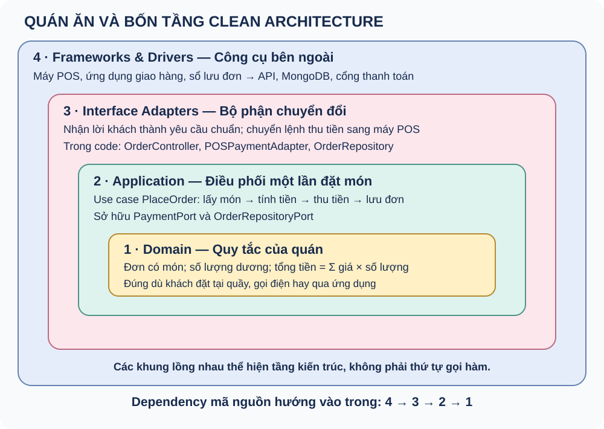
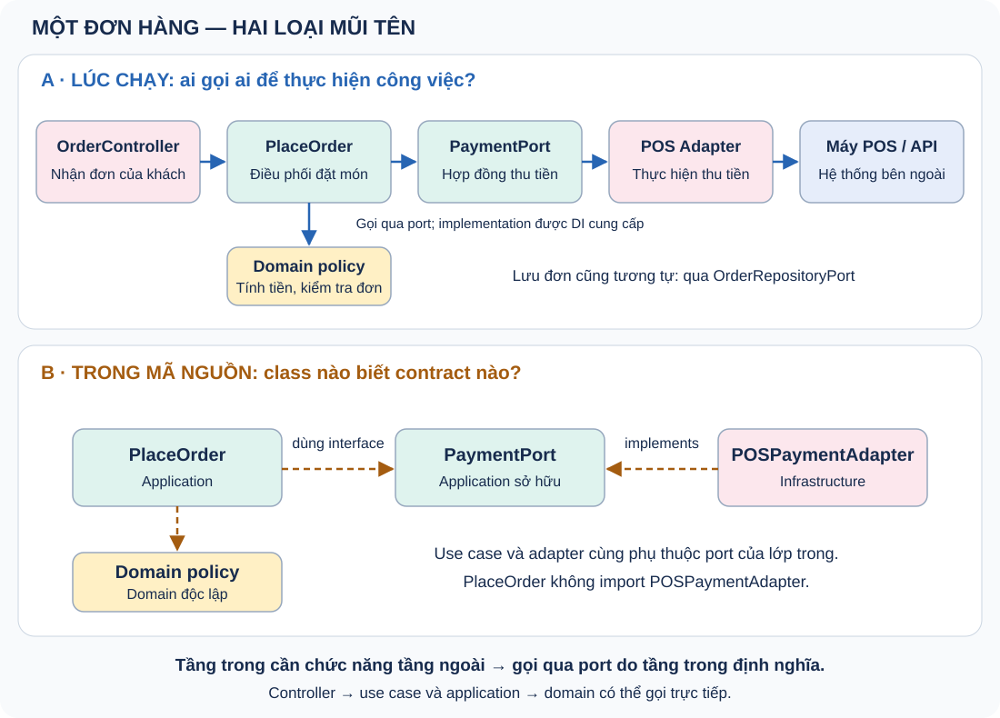

# Clean Architecture

Bảo vệ nghiệp vụ khỏi chi tiết công nghệ.

Ví dụ: thiết kế và code w-identity.

Note: Nêu rõ phần đã tự làm hoặc kiểm chứng; không nhận kinh nghiệm production từ ví dụ local.

---

## Hướng phụ thuộc

Application → Domain

Infrastructure → Application + Domain

Presentation → Application

Note: Phân biệt import trong mã nguồn với chiều gọi hàm khi chạy.

---

## Ports và adapters

Application sở hữu IdentityProviderPort và UserRepositoryPort.

KeycloakIdentityAdapter và UserRepository hiện thực các ports; use case chỉ nhận hợp đồng của Application.

Note: Interface thuộc bên cần nó; không trả object SDK qua port. Import type của class Infrastructure vẫn là dependency mã nguồn. AppModule dùng useExisting để gắn token hồ sơ với repository do DatabaseModule quản lý.

---

## Quy tắc profile trong Domain

`assertActiveAccount` bảo vệ thao tác profile của tài khoản đang hoạt động.

`validateProfilePatch` kiểm tra avatar URL, locale, timezone và giá trị field.

Note: Use case gọi policy trước khi lưu. DTO dùng lại policy, DomainError được filter chuyển thành 400/403. UserPersistenceEntity thuộc Infrastructure; User là mô hình Domain.

---

## Luồng cập nhật hồ sơ

TCP request → DTO → CommandBus → adapter → UpdateMyProfileHandler → domain/ports → response

Note: Quyền kiểm tra trong use case; ID lấy từ actor.

---

## Lỗi và kiểm thử

Không có transaction chung Keycloak/MongoDB.

Fake test nghiệp vụ + integration adapter + E2E.

Note: Timeout có thể xảy ra sau khi thao tác đã thành công.

---

## Đánh đổi

Thêm interface và mapper để có ranh giới dễ kiểm thử.

Chọn mức tách vừa đủ; CQRS tách command/query trong cùng worker và database.

Note: Kết thúc bằng một ví dụ và một hạn chế cụ thể.

---

## Quán ăn và bốn tầng

Note: Khách đặt hai phần cơm gà. Domain giữ quy tắc số lượng và tổng tiền; Application điều phối một lần đặt món; adapter chuyển yêu cầu; POS và database là công cụ bên ngoài.

---

## Quán ăn: gọi ra ngoài, phụ thuộc vào trong

Note: Application sở hữu PaymentPort. PlaceOrder gọi qua port; POSPaymentAdapter implements port. Đổi POS sang ví điện tử thì đổi adapter/wiring, giữ contract khi nghiệp vụ không đổi. Controller gọi use case và use case gọi Domain có thể trực tiếp.

---

## CQRS: bus định tuyến, handler thực thi

Commands: tạo/cập nhật tài khoản, cập nhật profile, khóa tài khoản, gửi email.

Queries: GetMe, GetUser, ListUsers.

Một UserRepositoryPort chung. Query đọc bằng findByUserId; profile chưa có trả null. Command cập nhật mới tạo profile.

Note: NestJS bus/decorator ở adapter; Application và Domain vẫn thuần. CQRS không bắt buộc tách database hoặc dùng Event Sourcing. Bus nội bộ không phải broker RabbitMQ.
