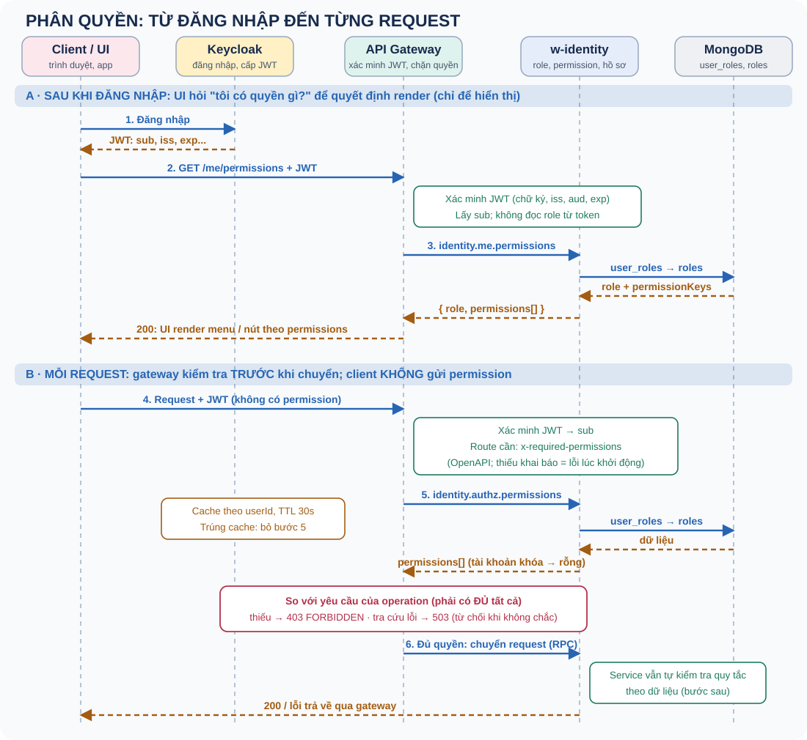
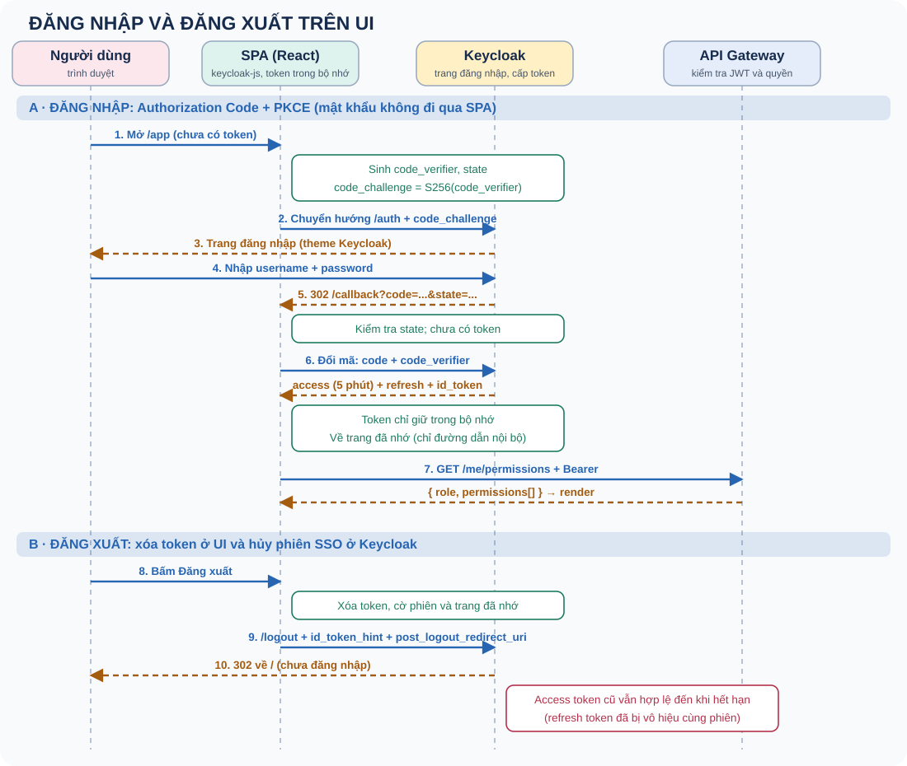

# Phân quyền (Authentication và Authorization) — học, ôn tập và phỏng vấn

Sổ tay riêng về cách hệ thống xác định **bạn là ai** và **bạn được làm gì**: từ đăng nhập ở Keycloak, UI render theo quyền, đến gateway chặn từng request. Ví dụ là thiết kế đã chốt cho w-identity và api-gateway; chi tiết kế hoạch ở `PLAN-AUTHZ.md` và `PLAN-ROLE-PERMISSION.md`.

Một phần của thiết kế đã được cài đặt và có kiểm thử (gateway), phần còn lại là thiết kế đã chọn. Bài 8 ghi rõ phần nào là phần nào. Đây chưa phải bằng chứng vận hành production.

Học theo thứ tự 0–9. Mỗi ngày đọc hai chủ đề, tự nói câu trả lời trong 60–90 giây rồi luyện thẻ câu hỏi. Trạng thái 📖 là tài liệu lý thuyết, không khẳng định bạn đã học thuộc.

## Bảng tiến độ

| # | Chủ đề | Bước PLAN | Trạng thái |
|---|---|---|---|
| 0 | Phân quyền trong 60 giây | Nền tảng | 📖 |
| 1 | Mô hình RBAC: role, permission và dữ liệu | Nền tảng | 📖 |
| 2 | Luồng tổng thể: từ đăng nhập đến từng request | Luồng | 📖 |
| 3 | UI render theo quyền | Luồng | 📖 |
| 4 | Gateway kiểm tra từng request | Luồng | 📖 |
| 5 | Tra cứu quyền: cache, single-flight và fail closed | Thiết kế | 📖 |
| 6 | Permission trong JWT hay tra cứu? | Thiết kế | 📖 |
| 7 | Hai lớp kiểm tra và những lỗi thường gặp | Thiết kế | 📖 |
| 8 | Trạng thái triển khai và cách nói khi phỏng vấn | Thực hành | 📖 |
| 9 | Đăng nhập và đăng xuất trên UI | Luồng | 📖 |

## 0. Phân quyền trong 60 giây

Hai câu hỏi khác nhau, do hai thành phần khác nhau trả lời:

| Câu hỏi | Tên gọi | Ai trả lời | Dữ liệu |
|---|---|---|---|
| Bạn là ai? | Authentication (xác thực) | Keycloak cấp JWT; gateway xác minh chữ ký, issuer, audience, hạn | JWT, chỉ dùng `sub` |
| Bạn được làm gì? | Authorization (phân quyền) | w-identity quyết định bằng role và permission | MongoDB: `user_roles`, `roles`, `permissions` |

Token chỉ nói bạn là ai. Role và permission nằm ngoài token, nên đổi quyền không cần cấp lại token. UI lấy permission để quyết định hiển thị; gateway kiểm tra thật ở mỗi request; service kiểm tra thêm các quy tắc theo dữ liệu.

**Bẫy phỏng vấn:** Gộp authentication với authorization; nói "đã có JWT nên đã phân quyền".

**Tự trả lời:** viết lại bằng lời của bạn, nêu một đánh đổi và một tình huống kiểm thử.

## 1. Mô hình RBAC: role, permission và dữ liệu

**RBAC (Role-Based Access Control):** user có role, role chứa các permission; quyền của user là quyền của role đó. Permission có dạng `resource:action`, ví dụ `users:read`, `roles:write`.

| Collection | Một document là gì | Vai trò |
|---|---|---|
| `users` | Hồ sơ của một tài khoản | Thông tin hồ sơ user tự sửa được; không chứa role |
| `user_roles` | Việc gán role cho một user | Mỗi user đúng một role (`keycloakUserId` unique); không có bản ghi thì coi là role `user` |
| `roles` | Định nghĩa một role | `name`, `permissionKeys[]`, cờ `system` (`admin`, `user` là role hệ thống, bất biến) |
| `permissions` | Danh mục permission hợp lệ | `key` dạng `resource:action`; role chỉ được gắn permission có trong đây |

Vì sao tách `users` và `user_roles`: hồ sơ là thứ user tự sửa qua `UpdateMyProfile`, còn role là đặc quyền chỉ quản trị viên được gán. Để hai nơi riêng nên user không thể sửa role của mình qua đường hồ sơ.

MongoDB không có khóa ngoại, nên các tham chiếu `user_roles.roleName → roles.name` và `roles.permissionKeys → permissions.key` do code tự bảo vệ (chặn xóa role hoặc permission đang được dùng). Role hệ thống được bảo vệ hai lớp: policy ở Domain và điều kiện `system: { $ne: true }` ngay trong câu lệnh Mongo, nên race cũng không sửa được.

**RBAC so với ABAC:** RBAC quyết định theo role; ABAC quyết định theo thuộc tính (chủ sở hữu, phòng ban, thời gian...). Nhiều hệ thống dùng RBAC làm lớp thô rồi thêm kiểm tra theo dữ liệu cho phần còn lại (xem bài 7).

**Bẫy phỏng vấn:** Nhầm RBAC với ABAC; để quy tắc "role hệ thống bất biến" chỉ ở controller; quên rằng MongoDB không có khóa ngoại nên phải tự bảo vệ tham chiếu.

**Tự trả lời:** viết lại bằng lời của bạn, nêu một đánh đổi và một tình huống kiểm thử.

## 2. Luồng tổng thể: từ đăng nhập đến từng request

Hai phần của luồng:

- **Phần A (sau khi đăng nhập):** UI gọi API lấy role và permission của chính mình để render. Chỉ để hiển thị.
- **Phần B (mỗi request):** gateway xác minh JWT, tra permission của user, so với yêu cầu của operation rồi mới chuyển request.

Nguyên tắc xuyên suốt: **client không bao giờ gửi permission**. Mọi thứ client gửi đều có thể bị giả, nên permission luôn được xác định ở phía server theo `sub` đã được xác minh.

**Bẫy phỏng vấn:** Để API tin permission do client gửi lên; không phân biệt phần hiển thị (UI) với phần cưỡng chế (server).

**Tự trả lời:** viết lại bằng lời của bạn, nêu một đánh đổi và một tình huống kiểm thử.

## 3. UI render theo quyền

Sau khi đăng nhập, UI gọi một API (`GET /me/permissions`, message pattern `identity.me.permissions`) để lấy `{ role, permissions[] }` của chính user, rồi ẩn hiện menu và nút theo `permissions`.

Hai điều cần nhớ:

- **Ẩn nút không phải bảo mật.** Ai cũng gọi API trực tiếp được, nên mọi thao tác nhạy cảm đều phải được chặn ở server.
- **Quyền có thể đổi sau khi UI đã tải.** UI nên tải lại permission khi nhận 403 hoặc định kỳ, thay vì tin dữ liệu cũ mãi.

Endpoint này khác `identity.users.getPermissions`: cái đó dành cho admin xem quyền của user khác, còn `me.permissions` luôn dùng danh tính của chính người gọi, nên không nhận userId từ client.

**Bẫy phỏng vấn:** Coi việc ẩn nút trên UI là đủ bảo mật; cache permission ở UI vô thời hạn.

**Tự trả lời:** viết lại bằng lời của bạn, nêu một đánh đổi và một tình huống kiểm thử.

## 4. Gateway kiểm tra từng request

Mỗi operation khai báo permission cần có ngay trong OpenAPI bằng extension `x-required-permissions` (mảng key `resource:action`, ngữ nghĩa **AND**: phải có đủ tất cả).

Luật kiểm tra khi gateway khởi động (từ chối mặc định):

| Trường hợp | Kết quả |
|---|---|
| Route cần đăng nhập, **thiếu** `x-required-permissions` | Lỗi, gateway không khởi động |
| `x-required-permissions: []` | Hợp lệ: chỉ cần đăng nhập (ví dụ `/me`) |
| Route công khai (`security: []`) có khai báo permission | Lỗi (vô nghĩa, dễ nhầm là đã được bảo vệ) |
| Key sai định dạng, trùng lặp hoặc không phải mảng chuỗi | Lỗi |

Khi chạy, bước `authorize` nằm giữa xác thực và gửi RPC:

1. route khớp, JWT hợp lệ, có `user.sub`;
2. `required` = permission của route; nếu rỗng thì bỏ qua;
3. lấy permission của `sub` (bài 5);
4. thiếu bất kỳ permission nào → `403 FORBIDDEN` (thông báo không liệt kê permission cần thiết, để không lộ cấu trúc phân quyền);
5. đủ quyền mới chuyển request tới service.

Contract-first có lợi ở đây: quy tắc phân quyền nằm cạnh định nghĩa API, kiểm tra được tự động, và quên khai báo thì không thể trở thành "mở toang".

**Bẫy phỏng vấn:** Thiếu khai báo mà mặc định cho qua; khai báo permission cho route công khai; liệt kê permission thiếu trong thông báo 403.

**Tự trả lời:** viết lại bằng lời của bạn, nêu một đánh đổi và một tình huống kiểm thử.

## 5. Tra cứu quyền: cache, single-flight và fail closed

Gateway tra permission của `sub` từ w-identity qua pattern nội bộ `identity.authz.permissions` (không có route HTTP trong OpenAPI). Phía w-identity: user → role đã gán (không có thì `user`) → `permissionKeys`. Tài khoản bị khóa trong Keycloak thì trả permission rỗng.

Để không tra DB ở mọi request, gateway bọc resolver bằng một cache:

| Kỹ thuật | Tác dụng |
|---|---|
| Cache theo `userId`, TTL ngắn (30 giây) | Giảm tải mà vẫn tươi |
| **Single-flight** | Nhiều request cùng user đang chờ chỉ gây **một** lần tra |
| Chỉ cache kết quả thành công | Lỗi không bị "nhớ", lần sau thử lại |
| Giới hạn số entry, bỏ entry cũ nhất khi đầy | Không phình bộ nhớ |

**Fail closed:** khi không tra được quyền (w-identity chết, phản hồi sai hợp đồng, hết giờ), gateway trả `503 AUTHZ_UNAVAILABLE` thay vì cho qua. An toàn hơn là cho phép khi không chắc. Đổi lại, khi w-identity chết thì route cần quyền không dùng được; route chỉ cần đăng nhập và route công khai vẫn chạy.

**Độ trễ chấp nhận được:** đổi role hoặc khóa tài khoản có hiệu lực sau tối đa một TTL. Muốn nhanh hơn thì hạ TTL hoặc thu hồi cache chủ động (chưa làm).

**Bẫy phỏng vấn:** Gọi DB ở mọi request mà không cache; cache cả lỗi; cho request đi tiếp khi lookup lỗi; quên rằng cache làm quyền đổi có độ trễ.

**Tự trả lời:** viết lại bằng lời của bạn, nêu một đánh đổi và một tình huống kiểm thử.

## 6. Permission trong JWT hay tra cứu?

| Tiêu chí | Permission trong JWT | Tra cứu có cache (đã chọn) |
|---|---|---|
| Cần gọi service khác mỗi request | Không | Có (cache giảm đáng kể) |
| Đổi quyền có hiệu lực | Chậm: token cũ giữ quyền cũ đến khi hết hạn | Nhanh: tối đa một TTL |
| Đồng bộ với Keycloak | Phải đồng bộ MongoDB và Keycloak | Không cần |
| Kích thước token | Lớn dần khi nhiều permission | Không đổi |
| Khi service phân quyền chết | Vẫn chạy được | Route cần quyền trả 503 |
| Thu hồi quyền khẩn cấp | Khó (cần token ngắn hạn hoặc danh sách thu hồi) | Dễ (khóa tài khoản, đổi role) |

Chọn JWT khi muốn tránh phụ thuộc lúc chạy và chấp nhận độ trễ khi đổi quyền (kèm token hết hạn ngắn). Chọn tra cứu khi cần kiểm soát độ tươi và thu hồi nhanh. Dự án này chọn tra cứu có cache, đồng thời **bỏ đọc `roles` từ claim JWT** ở gateway để chỉ còn một nguồn sự thật.

Lưu ý: "gửi permission trong request" chỉ an toàn nếu đó chính là JWT đã ký. Một danh sách permission riêng do client gửi thì không bao giờ an toàn.

**Bẫy phỏng vấn:** Không giải thích được vì sao chọn một trong hai; để hai nguồn sự thật cho role (JWT và DB) cùng tồn tại.

**Tự trả lời:** viết lại bằng lời của bạn, nêu một đánh đổi và một tình huống kiểm thử.

## 7. Hai lớp kiểm tra và những lỗi thường gặp

Gateway kiểm tra **thô theo operation** ("gọi `users.create` cần `users:write`"). Service kiểm tra **theo dữ liệu** những gì OpenAPI không diễn đạt được:

- chỉ được sửa hồ sơ của chính mình (danh tính lấy từ `Actor`, không nhận `userId` trong body);
- không gỡ role admin cuối cùng; không tự hạ quyền của mình;
- tài khoản đang bị khóa.

Đây là **defense in depth**: service không nên tin tuyệt đối rằng gateway đã chặn, vì service có thể bị gọi từ chỗ khác (pattern TCP nội bộ không đi qua OpenAPI).

Rủi ro cần biết:

| Rủi ro | Giảm thiểu |
|---|---|
| Pattern nội bộ `identity.authz.permissions` gọi được bởi bất kỳ client nào tới được cổng TCP | Không đưa vào OpenAPI; mô hình tin cậy mạng nội bộ; cần chính sách mạng hoặc khóa dùng chung ở bước sau |
| Danh mục lệch: key trong OpenAPI không tồn tại trong `permissions` | Kiểm tra key trong spec với danh sách seed |
| Cache cũ sau khi đổi quyền | TTL ngắn; tài liệu hóa độ trễ |
| Leo thang đặc quyền (user tự đặt role cho mình) | Role chỉ gán qua use case của quản trị; `users` không chứa role; input không bao giờ chứa cờ quyền |

**Bẫy phỏng vấn:** Chỉ kiểm tra ở gateway rồi tin service tuyệt đối; để request body quyết định ai là người thực hiện.

**Tự trả lời:** viết lại bằng lời của bạn, nêu một đánh đổi và một tình huống kiểm thử.

## 8. Trạng thái triển khai và cách nói khi phỏng vấn

Trạng thái tại 2026-11-09:

| Phần | Trạng thái |
|---|---|
| Gateway: đọc và kiểm tra `x-required-permissions` khi khởi động; resolver có cache; chặn 403/503; bỏ đọc role từ JWT | Đã làm; test Jest chạy với Node 24 theo `.nvmrc` |
| w-identity: mô hình role/permission, seed, repository, handler | Đã làm theo `PLAN-ROLE-PERMISSION.md`; thao tác quản lý hiện vẫn bị `management()` từ chối |
| w-identity: `identity.me.permissions` và `identity.authz.permissions` | Đã làm; tài khoản khóa trả permission rỗng cho tra cứu nội bộ |
| Cập nhật `specs/identity/openapi.yml` (route RBAC, `x-required-permissions`) | Đã làm; spec thực tế được kiểm tra trong test gateway |
| Bật lại kiểm tra quyền trong w-identity (`AuthorizationPolicy` thay `management()`) | Chưa làm, tách riêng |
| UI đăng nhập/đăng xuất (`apps/u-project-management`), fixture realm `pm` + client `pm-web`, CORS ở gateway | Đã làm; luồng PKCE, đăng xuất và xoay vòng refresh token đã kiểm chứng với Keycloak thật trên realm tạm; UI có 43 test (chạy với auth giả) |

Khi phỏng vấn, chỉ nói những phần đã làm và đã kiểm chứng; phần còn lại nói rõ là thiết kế đã chọn và lý do.

### Câu trả lời mẫu 60–90 giây

“Đăng nhập ở Keycloak, token chỉ cho biết user là ai. Role và permission em để ở MongoDB của w-identity. Sau khi đăng nhập, UI gọi một API để lấy permission của chính user rồi render, nhưng đó chỉ là hiển thị. Việc chặn thật xảy ra ở gateway: mỗi operation khai báo permission cần có trong OpenAPI, gateway lấy `sub` từ JWT đã xác minh, tra permission từ w-identity có cache ngắn, so sánh rồi mới chuyển request. Client không bao giờ gửi permission vì có thể bị giả. Nếu không tra được thì từ chối, không cho qua. Đánh đổi là gateway phụ thuộc w-identity và quyền đổi có độ trễ tối đa bằng TTL cache.”

**Tự kiểm tra:** vì sao permission nên được tra theo `sub` đã xác minh thay vì nhận từ request? Khi nào chọn permission-trong-JWT? Đổi role của user có hiệu lực sau bao lâu và vì sao? Khóa tài khoản trong Keycloak ảnh hưởng thế nào khi JWT còn hạn?

**Bẫy phỏng vấn:** Kể thiết kế dự kiến như thành tích đã làm.

**Tự trả lời:** viết lại bằng lời của bạn, nêu một đánh đổi và một tình huống kiểm thử.

## 9. Đăng nhập và đăng xuất trên UI

Chi tiết kế hoạch: `PLAN-AUTH-UI.md`. Mã nằm ở `apps/u-project-management` (React), cấu hình client ở `apps/w-identity/fixtures/pm-realm.json`.

### Nguyên tắc: SPA không nhận mật khẩu

SPA chuyển hướng sang trang đăng nhập của Keycloak (theme tùy biến ở `apps/keycloak-theme`), rồi nhận lại một **mã**. Cách này là **Authorization Code + PKCE**. Mật khẩu chỉ đi giữa trình duyệt và Keycloak; w-identity cũng không có endpoint đăng nhập.

### Vì sao cần PKCE

SPA là *public client*, không giữ được secret. PKCE thay secret bằng một cặp: SPA sinh `code_verifier` ngẫu nhiên rồi gửi `code_challenge = SHA256(code_verifier)` khi bắt đầu; khi đổi mã lấy token phải gửi lại `code_verifier`. Kẻ chặn được mã không có `code_verifier` nên không đổi được token. Đã kiểm chứng với Keycloak: đổi mã bằng verifier sai trả 400.

### Các điểm thiết kế

| Quyết định | Lý do | Đánh đổi |
|---|---|---|
| Token chỉ trong bộ nhớ, không `localStorage` | XSS không đọc được từ kho lưu trữ | F5 làm mất token; phải hỏi lại Keycloak (phiên SSO) |
| Cờ gợi ý `pm.session-hint` trong `localStorage` (không phải token) | Chỉ khi có cờ mới kiểm tra SSO lúc tải trang, khách mới không bị chuyển hướng vô ích | Cờ có thể sai (phiên đã hết hạn): kiểm tra SSO trả về chưa đăng nhập, cờ bị xóa |
| `redirect_uri` khai báo chính xác `/callback`, không ký tự đại diện | Chặn gửi mã tới địa chỉ lạ | Mỗi môi trường phải đăng ký URL |
| Trang quay lại sau đăng nhập chỉ nhận đường dẫn nội bộ | Chặn open redirect | Phải kiểm tra giá trị đã lưu như dữ liệu không tin cậy |
| Làm mới token trước khi gọi API; 401 thì làm mới và thử lại **đúng một lần** | Người dùng không thấy gián đoạn; không lặp vô hạn | Phức tạp hơn gọi thẳng |
| 403 không đăng xuất, chỉ tải lại quyền | Bị từ chối quyền khác với hết phiên | UI phải phân biệt 401, 403, 503 |
| Refresh token xoay vòng (rotation) | Token bị lộ chỉ dùng được một lần | Dùng lại token cũ bị từ chối (đã kiểm chứng 400) |

### Đăng xuất

Hai việc phải cùng làm: **xóa token ở UI** và **hủy phiên SSO ở Keycloak** (chuyển hướng tới `/logout` kèm `id_token_hint` và `post_logout_redirect_uri`). Chỉ xóa ở UI thì lần sau Keycloak vẫn đăng nhập ngầm bằng cookie SSO. `post_logout_redirect_uri` phải được đăng ký trước, địa chỉ lạ bị từ chối (đã kiểm chứng 400).

**Đăng xuất không thu hồi access token đã cấp.** Nó vẫn hợp lệ đến khi hết hạn (5 phút). Giảm rủi ro bằng token sống ngắn; refresh token bị vô hiệu cùng phiên (đã kiểm chứng: làm mới sau khi đăng xuất trả 400).

### Xử lý lỗi ở UI

| Phản hồi | Hành vi |
|---|---|
| 401 | Làm mới token, thử lại một lần; vẫn 401 thì báo "Phiên đã hết hạn" |
| 403 | Không đăng xuất; tải lại `/me/permissions`, báo không có quyền |
| 503 `AUTHZ_UNAVAILABLE` | Lỗi tạm thời, cho thử lại; **không** coi là bị từ chối quyền |
| Mất kết nối | Lỗi tạm thời có thể thử lại |

### CORS

Trình duyệt chặn lời gọi từ origin của UI tới gateway nếu thiếu CORS. Gateway trả lời preflight `OPTIONS` **trước** bước xác thực (preflight không mang token), chỉ chấp nhận origin được cấu hình chính xác (`GATEWAY_CORS_ORIGINS`, không dùng `*` vì có `Authorization`), và origin lạ nhận 403.

**Bẫy phỏng vấn:** Tự làm form username/password trong SPA; lưu token vào `localStorage`; dùng luồng Implicit hoặc Password; nghĩ đăng xuất đã thu hồi token; dùng `redirect_uri` có ký tự đại diện; để open redirect qua tham số "quay lại sau đăng nhập"; đặt CORS `*` cùng `Authorization`.

**Tự trả lời:** vì sao PKCE bảo vệ được SPA không có secret? Khi nhấn F5, người dùng có phải nhập lại mật khẩu không và vì sao? Đăng xuất xong, access token cũ còn dùng được bao lâu?

## Từ điển nhanh

| Thuật ngữ | Giải thích |
|---|---|
| Authentication | Xác định bạn là ai (JWT hợp lệ, `sub`) |
| Authorization | Xác định bạn được làm gì (role, permission) |
| RBAC | Phân quyền theo role: user có role, role chứa permission |
| ABAC | Phân quyền theo thuộc tính (chủ sở hữu, phòng ban, thời gian...) |
| Permission | Một quyền cụ thể dạng `resource:action` |
| Role | Tập permission được đặt tên; mỗi user đúng một role |
| JWT | Token đã ký do Keycloak cấp; gateway xác minh và lấy `sub` |
| `x-required-permissions` | Extension OpenAPI khai báo permission cần có cho một operation |
| Deny by default | Thiếu khai báo thì từ chối, không cho qua |
| Fail closed | Khi không chắc (không tra được quyền) thì từ chối thay vì cho qua |
| Single-flight | Nhiều yêu cầu cùng khóa đang chờ chỉ gây một lần tra cứu |
| TTL cache | Cache hết hạn sau một khoảng thời gian; quyết định độ tươi của quyền |
| Defense in depth | Nhiều lớp kiểm tra độc lập (gateway và service) |
| Leo thang đặc quyền | Một user tự có quyền cao hơn mức được cấp |
| Authorization Code + PKCE | Luồng đăng nhập cho SPA: đổi mã lấy token kèm `code_verifier`, không cần secret |
| code_verifier / code_challenge | Chuỗi ngẫu nhiên và băm SHA-256 của nó; chứng minh người đổi mã chính là người bắt đầu luồng |
| Public client | Ứng dụng không giữ được secret (SPA, mobile) |
| SSO session | Phiên của người dùng ở Keycloak; quyết định có đăng nhập ngầm được hay không |
| Refresh token rotation | Mỗi lần làm mới cấp refresh token mới, token cũ không dùng lại được |
| CORS preflight | Yêu cầu OPTIONS trình duyệt gửi trước khi gọi khác origin; không mang token |
| Open redirect | Lỗ hổng chuyển hướng người dùng tới địa chỉ lạ qua tham số URL |

## Nguồn và cách dùng

Thiết kế và quyết định lấy từ `PLAN-AUTHZ.md` và `PLAN-ROLE-PERMISSION.md`. Tên collection, pattern và quy tắc là lựa chọn của dự án này, không phải quy định duy nhất của RBAC.
