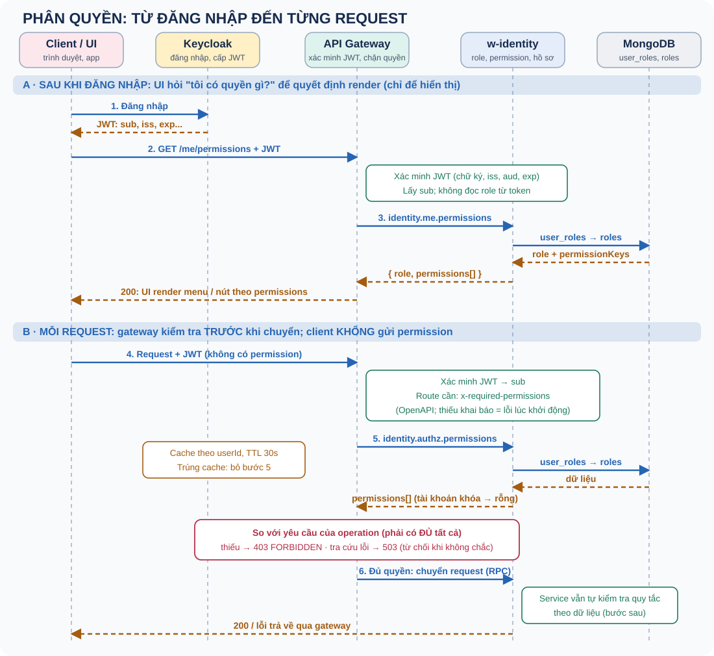
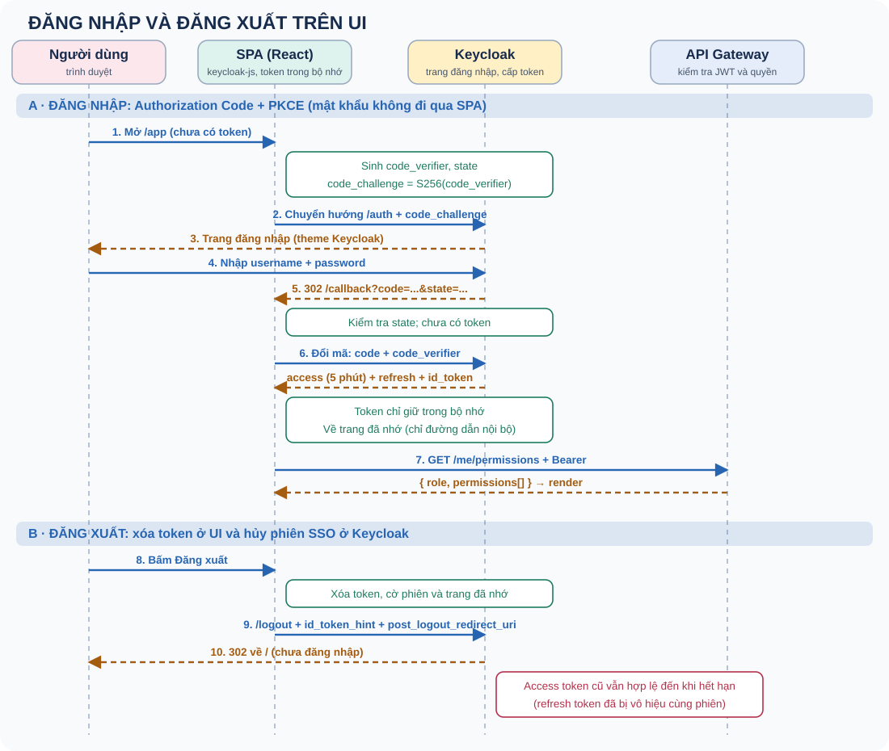

# Phân quyền

Xác thực và phân quyền: từ đăng nhập đến từng request.

Ví dụ: Keycloak, api-gateway và w-identity.

Note: Một phần đã cài đặt và có test (gateway), phần còn lại là thiết kế đã chọn. Nêu rõ ranh giới khi trình bày.

---

## Hai câu hỏi khác nhau

Bạn là ai? → Authentication: Keycloak cấp JWT, gateway xác minh, chỉ dùng `sub`.

Bạn được làm gì? → Authorization: w-identity quyết định bằng role và permission.

Note: Token chỉ nói bạn là ai. Role và permission nằm ở MongoDB nên đổi quyền không cần cấp lại token.

---

## Mô hình RBAC

User → role → permission (`resource:action`). Mỗi user đúng một role.

Collection: `users` (hồ sơ), `user_roles`, `roles`, `permissions`.

Note: Tách `users` khỏi `user_roles` để user không sửa được role qua hồ sơ. Role hệ thống admin/user bất biến, được bảo vệ hai lớp (policy và điều kiện trong câu lệnh Mongo).

---

## Luồng phân quyền

Note: Phần A: UI lấy permission để render (chỉ hiển thị). Phần B: mỗi request gateway xác minh JWT, tra quyền có cache, so với yêu cầu của operation rồi mới chuyển. Client không bao giờ gửi permission.

---

## Gateway kiểm tra từng request

Mỗi operation khai báo `x-required-permissions` trong OpenAPI (AND).

Thiếu khai báo → gateway không khởi động. Thiếu quyền → 403. Không tra được → 503 (fail closed).

Note: Từ chối mặc định: quên khai báo không thể trở thành mở toang. Thông báo 403 không liệt kê permission thiếu.

---

## Cache quyền

Cache theo userId, TTL 30 giây, single-flight, không cache lỗi, giới hạn số entry.

Đổi quyền hoặc khóa tài khoản có hiệu lực sau tối đa một TTL.

Note: Phương án khác là permission trong JWT: không cần tra cứu nhưng token cũ giữ quyền cũ và phải đồng bộ với Keycloak.

---

## Hai lớp kiểm tra

Gateway: thô theo operation. Service: theo dữ liệu (chỉ sửa hồ sơ của mình, không gỡ admin cuối cùng).

Note: Defense in depth. Service không nên tin tuyệt đối rằng gateway đã chặn. Chỉ nói phần đã làm và kiểm chứng.

---

## Đăng nhập trên UI

Note: SPA không nhận mật khẩu. Authorization Code + PKCE: sinh code_verifier, chuyển hướng sang Keycloak, nhận mã ở /callback, đổi mã kèm code_verifier. Token chỉ trong bộ nhớ.

---

## Đăng xuất và xử lý lỗi

Xóa token ở UI và hủy phiên SSO ở Keycloak (id_token_hint + post_logout_redirect_uri).

401: làm mới và thử lại một lần. 403: tải lại quyền. 503: thử lại, không coi là bị từ chối.

Note: Access token cũ vẫn hợp lệ đến khi hết hạn (5 phút); refresh token bị vô hiệu cùng phiên. CORS: gateway trả lời preflight trước xác thực, chỉ nhận origin cấu hình chính xác.

