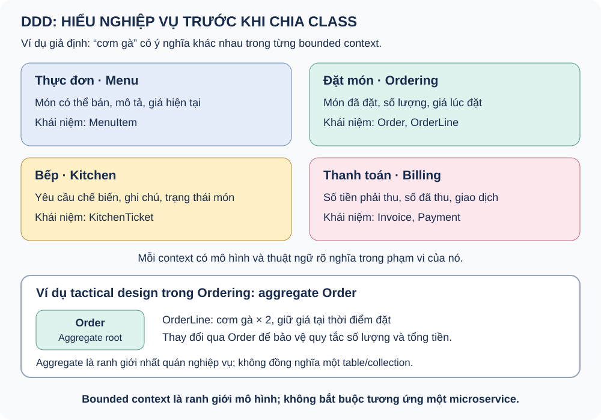

# Domain-Driven Design — học, ôn tập và phỏng vấn

Sổ tay riêng về DDD, tách khỏi sổ tay Clean Architecture. Phần so sánh DDD với Clean Architecture và CQRS nằm ở bài 14 của sổ tay Clean Architecture.

Ví dụ xuyên suốt là **nhà hàng** (Thực đơn, Đặt món, Bếp, Thanh toán). Đây là ví dụ học khái niệm, không phải code đã triển khai. Riêng bài 7 nói về mức áp dụng DDD ở **w-identity** và chỉ khẳng định những gì code thực sự có.

Học theo thứ tự 0–7. Mỗi ngày đọc hai chủ đề, tự nói câu trả lời trong 60–90 giây rồi luyện thẻ câu hỏi. Trạng thái 📖 là tài liệu lý thuyết, không khẳng định bạn đã học thuộc.

## Bảng tiến độ

| # | Chủ đề | Bước PLAN | Trạng thái |
|---|---|---|---|
| 0 | DDD trong 60 giây | Strategic | 📖 |
| 1 | Ubiquitous Language và Bounded Context | Strategic | 📖 |
| 2 | Subdomain và Context Map | Strategic | 📖 |
| 3 | Ví dụ nhà hàng: cùng một món, nhiều ý nghĩa | Strategic | 📖 |
| 4 | Entity, Value Object và Aggregate | Tactical | 📖 |
| 5 | Repository, Factory, Service và Event | Tactical | 📖 |
| 6 | Anemic Model, Event Storming và khi nào nên dùng DDD | Thực hành | 📖 |
| 7 | DDD ở w-identity: áp dụng đến đâu | Thực hành | 📖 |

## 0. DDD trong 60 giây

**DDD (Domain-Driven Design) là cách tiếp cận phát triển và thiết kế phần mềm lấy nghiệp vụ làm trung tâm.** Nhóm phát triển cùng người am hiểu nghiệp vụ khám phá khái niệm, thống nhất ngôn ngữ, tìm ranh giới và thể hiện mô hình đó trong code; mô hình tiếp tục được điều chỉnh khi hiểu biết thay đổi.

DDD rộng hơn một design pattern hay một cách chia folder. Tạo `domain/`, dùng repository, thêm CQRS hoặc viết class có tên Entity chưa đủ để kết luận đã áp dụng DDD tốt.

DDD có hai nửa:

| Nửa | Câu hỏi | Công cụ chính |
|---|---|---|
| **Strategic Design** | Nghiệp vụ gồm những phần nào, ngôn ngữ và ranh giới ở đâu, các phần quan hệ với nhau ra sao? | Ubiquitous Language, Bounded Context, Subdomain, Context Map |
| **Tactical Design** | Trong một ranh giới, thể hiện mô hình bằng code thế nào? | Entity, Value Object, Aggregate, Repository, Domain Service, Domain Event |

Strategic đi trước: nếu chọn sai ranh giới thì pattern tactical đẹp đến đâu cũng chỉ mô hình hóa sai bài toán.

**Bẫy phỏng vấn:** Nói DDD là "chia thư mục domain/application/infrastructure" hoặc "dùng entity và repository".

**Tự trả lời:** viết lại bằng lời của bạn, nêu một đánh đổi và một tình huống kiểm thử.

## 1. Ubiquitous Language và Bounded Context

- **Ubiquitous Language:** developer và người hiểu nghiệp vụ dùng chung thuật ngữ, cùng nghĩa trong từng context; tên trong tài liệu, trao đổi và code phản ánh ngôn ngữ đó. Nếu chuyên gia nói "xác nhận đơn" mà code gọi `updateStatus(2)` thì ngôn ngữ chưa chung.
- **Bounded Context:** phạm vi một mô hình và ngôn ngữ có nghĩa nhất quán. Cùng một từ ở context khác có thể cần một mô hình khác. "Khách hàng" ở Bán hàng (người đặt đơn) khác "khách hàng" ở Chăm sóc (người có ticket hỗ trợ).

Bounded context không bắt buộc trùng với một service triển khai. Một ứng dụng có thể chứa nhiều context; ranh giới cần được quyết định từ nghiệp vụ và khả năng tổ chức, không chỉ từ sơ đồ hạ tầng. Ngược lại, một mô hình dùng chung cho mọi nơi ("God model") thường là dấu hiệu thiếu ranh giới.

**Bẫy phỏng vấn:** Đồng nhất bounded context với microservice; hoặc dùng một class `Customer` khổng lồ cho mọi context.

**Tự trả lời:** viết lại bằng lời của bạn, nêu một đánh đổi và một tình huống kiểm thử.

## 2. Subdomain và Context Map

**Subdomain** là phần của bài toán nghiệp vụ, phân loại theo giá trị chiến lược:

| Loại | Đặc điểm | Cách đầu tư |
|---|---|---|
| Core | Tạo lợi thế cạnh tranh, thay đổi nhiều | Mô hình sâu, đội giỏi nhất, tự xây |
| Supporting | Cần thiết nhưng không phân biệt công ty | Làm đơn giản, có thể giao đội khác |
| Generic | Bài toán chung đã có giải pháp (đăng nhập, thanh toán, gửi mail) | Mua hoặc dùng sản phẩm có sẵn |

Subdomain thuộc *không gian bài toán*; bounded context thuộc *không gian giải pháp*. Lý tưởng là khớp nhau nhưng không phải lúc nào cũng một-một.

**Context Map** mô tả quan hệ giữa các context: bên nào sở hữu dữ liệu/quy tắc nào, trao đổi bằng hợp đồng nào, cần dịch mô hình ở ranh giới ra sao.

| Kiểu quan hệ | Ý nghĩa ngắn |
|---|---|
| Shared Kernel | Hai context dùng chung một phần mô hình/code nhỏ, hai bên cùng chịu trách nhiệm đồng bộ |
| Customer–Supplier | Upstream (supplier) cung cấp, downstream (customer) có tiếng nói trong việc ưu tiên yêu cầu |
| Conformist | Downstream chấp nhận mô hình upstream nguyên trạng, không có ảnh hưởng |
| Anticorruption Layer (ACL) | Downstream đặt lớp dịch để mô hình ngoài không làm "nhiễm" mô hình của mình |
| Open Host Service / Published Language | Upstream công bố giao thức và ngôn ngữ chung ổn định cho nhiều bên dùng |
| Separate Ways | Hai context không tích hợp |

**Bẫy phỏng vấn:** Áp tactical pattern đầy đủ cho cả subdomain generic; không biết khi nào cần ACL.

**Tự trả lời:** viết lại bằng lời của bạn, nêu một đánh đổi và một tình huống kiểm thử.

## 3. Ví dụ nhà hàng: cùng một món, nhiều ý nghĩa



Đây là các ranh giới **minh họa**, không phải cách chia duy nhất cho mọi nhà hàng:

- **Thực đơn:** “cơm gà” là một món có thể bán, có mô tả và giá hiện tại.
- **Đặt món:** món trong đơn có số lượng và giá được ghi nhận tại thời điểm đặt.
- **Bếp:** món là yêu cầu chế biến với ghi chú và trạng thái thực hiện.
- **Thanh toán:** thông tin món góp phần xác định khoản tiền cần thu trên hóa đơn.

Nếu nhà hàng có quy tắc “đổi giá thực đơn không làm thay đổi giá các đơn đã xác nhận”, Ordering cần giữ giá tại thời điểm đặt. Việc nhận ra ý nghĩa và quy tắc này là công việc mô hình hóa domain; sau đó mới chọn cấu trúc class và cách lưu trữ phù hợp.

Quan hệ giữa các context cũng cần quyết định: Ordering có thể là upstream của Kitchen (Kitchen nhận sự kiện "đơn đã xác nhận" và dịch thành ticket của mình), còn Billing có thể đặt ACL nếu phải tích hợp cổng thanh toán bên ngoài có mô hình riêng.

**Tự kiểm tra:** Giải thích vì sao OrderLine giữ giá lúc đặt; vì sao "món" ở Kitchen không cần giá; ai là upstream giữa Ordering và Kitchen.

**Tự trả lời:** viết lại bằng lời của bạn, nêu một đánh đổi và một tình huống kiểm thử.

## 4. Entity, Value Object và Aggregate

| Khái niệm | Vai trò | Ví dụ nhà hàng giả định |
|---|---|---|
| Entity | Có danh tính và vòng đời; thay thuộc tính vẫn là cùng thực thể | Order có orderId |
| Value Object | Được xác định bởi giá trị, bảo vệ tính hợp lệ; thường thiết kế bất biến | Money gồm amount và currency |
| Aggregate / Aggregate Root | Nhóm đối tượng trong một ranh giới nhất quán; root kiểm soát thay đổi để bảo vệ bất biến | Order kiểm soát các OrderLine, số lượng và cách tính tổng tiền |

**Value Object so với Entity:** hai Money(50, VND) là bằng nhau vì cùng giá trị; hai Order cùng nội dung nhưng khác `orderId` là hai đơn khác nhau. Value Object nên bất biến: muốn đổi thì tạo giá trị mới.

**Quy tắc thiết kế aggregate (theo Vaughn Vernon):**

- Bảo vệ bất biến *trong một transaction*; một transaction thường chỉ sửa một aggregate.
- Giữ aggregate nhỏ. Aggregate lớn gây tranh chấp khóa và tải dữ liệu thừa.
- Tham chiếu aggregate khác bằng **ID**, không giữ object trực tiếp.
- Nhất quán giữa các aggregate là **eventual consistency**, thường qua domain event.

Mã giả minh họa (không phải code của repo):

```text
Order (aggregate root)
  confirm()           // kiểm tra: có ít nhất 1 OrderLine, số lượng > 0
  addLine(menuItemId, qty, unitPrice: Money)
  total(): Money      // tổng unitPrice * qty, luôn tính từ các OrderLine
  // ngoài truy cập OrderLine chỉ qua Order, không sửa trực tiếp
```

Aggregate không mặc định là một table/collection; domain entity cũng không đồng nghĩa model có decorator ORM. Aggregate cũng không nhất thiết là class: mô hình dựa trên kiểu dữ liệu và hàm thuần vẫn có thể bảo vệ bất biến.

**Bẫy phỏng vấn:** Cho một aggregate chứa cả hệ thống; giữ object aggregate khác thay vì ID; coi aggregate là bảng database.

**Tự trả lời:** viết lại bằng lời của bạn, nêu một đánh đổi và một tình huống kiểm thử.

## 5. Repository, Factory, Service và Event

| Khái niệm | Vai trò | Ví dụ nhà hàng giả định |
|---|---|---|
| Repository | Giao diện giống một tập hợp để lấy và lưu **aggregate root**; thường mỗi aggregate một repository | OrderRepository lưu và nạp cả Order cùng OrderLine |
| Factory | Tạo aggregate phức tạp ở trạng thái hợp lệ ngay từ đầu | Tạo Order từ giỏ hàng, đảm bảo có ít nhất một món |
| Domain Service / Policy | Diễn đạt quy tắc không tự nhiên thuộc riêng một entity/value object | Chính sách xác định món có được áp dụng khuyến mãi |
| Domain Event | Diễn đạt một sự kiện nghiệp vụ đã xảy ra | OrderConfirmed |

**Domain Service so với Application Service:** Domain Service chứa quy tắc nghiệp vụ không thuộc riêng entity nào (chỉ dùng mô hình domain). Application Service (use case) điều phối: kiểm tra quyền, mở transaction, gọi repository, gọi domain, phát event; nó không chứa quy tắc nghiệp vụ.

**Domain Event so với Integration Event:** Domain Event xảy ra *trong* một bounded context và dùng ngôn ngữ của nó. Integration Event là hợp đồng công bố ra *context khác* qua broker, cần ổn định phiên bản và thường đi qua outbox để không mất. Một domain event có thể được chuyển thành integration event, nhưng đó là hai thứ khác nhau. Domain event là khái niệm nghiệp vụ và không tự bảo đảm được gửi bền vững qua broker.

**Bẫy phỏng vấn:** Repository cho từng bảng thay vì từng aggregate; để Application Service chứa toàn bộ quy tắc; coi domain event là message RabbitMQ.

**Tự trả lời:** viết lại bằng lời của bạn, nêu một đánh đổi và một tình huống kiểm thử.

## 6. Anemic Model, Event Storming và khi nào nên dùng DDD

**Anemic Domain Model (anti-pattern):** entity chỉ có getter/setter, mọi quy tắc nằm trong service nên model không tự bảo vệ bất biến. Trái lại, không phải mô hình nào cũng cần class giàu hành vi: hàm thuần và kiểu dữ liệu là lựa chọn có chủ đích khi quy tắc ít và đơn giản.

**Event Storming:** workshop dùng giấy dán để cùng chuyên gia nghiệp vụ liệt kê domain event, command, aggregate rồi tìm ranh giới context. Đây là cách phổ biến để khám phá domain trước khi viết code.

**Khi nào nên dùng DDD đầy đủ:** nghiệp vụ phức tạp, quy tắc thay đổi nhiều, cần hợp tác chặt với chuyên gia nghiệp vụ, và là subdomain core. **Khi nào nên nhẹ:** CRUD đơn giản, subdomain generic/supporting, đội nhỏ, hoặc nghiệp vụ đã có sản phẩm giải quyết. Chọn những pattern giải quyết quy tắc thực tế; không cần thêm đủ mọi loại class để được gọi là DDD.

**Bẫy phỏng vấn:** Áp dụng đủ mọi pattern cho một service CRUD; hoặc ngược lại, bỏ qua việc làm rõ ngôn ngữ vì "chỉ là CRUD".

**Tự trả lời:** viết lại bằng lời của bạn, nêu một đánh đổi và một tình huống kiểm thử.

## 7. DDD ở w-identity: áp dụng đến đâu

Identity (đăng nhập, tài khoản, hồ sơ) thường là **generic subdomain**: Keycloak đã giải quyết phần lớn, và w-identity chủ yếu đồng bộ/điều phối giữa Keycloak và hồ sơ trong MongoDB. Ở w-identity **không có aggregate nào**: `User` là mô hình hồ sơ với vài quy tắc, được biểu diễn bằng kiểu dữ liệu và hàm policy.

- Phần w-identity thể hiện được là *tư tưởng* DDD ở mức nhẹ: tách Domain khỏi hạ tầng, đặt tên theo ngôn ngữ nghiệp vụ (`assertActiveAccount`), `UserAccount` (Keycloak) tách khỏi `User` (hồ sơ) như hai mô hình cho hai nguồn dữ liệu khác nhau.
- Phần **không** nên nhận là đã làm: aggregate, value object, domain event, context map. Ví dụ nhà hàng ở bài 3–5 phục vụ để học các khái niệm này, không phải mô tả code w-identity.
- Khi phỏng vấn, nói rõ ranh giới đó. Nói "w-identity không cần DDD đầy đủ vì đây là subdomain generic, tôi hiểu DDD qua ví dụ nhà hàng" đáng tin hơn là gán nhãn DDD cho một service gần CRUD.

### Câu trả lời mẫu 60 giây

“DDD là cách tiếp cận lấy mô hình nghiệp vụ làm trung tâm. Strategic Design giúp thống nhất ngôn ngữ và tìm bounded context; Tactical Design giúp hiện thực mô hình bằng entity, value object, aggregate hoặc policy phù hợp. Ví dụ ở nhà hàng, Menu và Ordering hiểu món ăn theo mục đích riêng; việc giữ giá tại thời điểm đặt là một quy tắc cần được mô hình hóa rõ. Ở w-identity em chỉ áp dụng DDD nhẹ vì identity là subdomain generic.”

**Tự kiểm tra:** Subdomain khác bounded context ở đâu; vì sao aggregate tham chiếu aggregate khác bằng ID; Domain Event khác Integration Event thế nào; khi nào dùng ACL; nêu một quy tắc thật cần aggregate và một trường hợp chỉ cần policy thuần.

**Bẫy phỏng vấn:** Gán nhãn DDD cho code chỉ vì có thư mục domain; kể thiết kế dự kiến như thành tích đã làm.

**Tự trả lời:** viết lại bằng lời của bạn, nêu một đánh đổi và một tình huống kiểm thử.

Nguồn tham khảo: [Martin Fowler — Domain-Driven Design](https://martinfowler.com/bliki/DomainDrivenDesign.html), [Microsoft — thiết kế service theo DDD](https://learn.microsoft.com/en-us/dotnet/architecture/microservices/microservice-ddd-cqrs-patterns/ddd-oriented-microservice).

## Từ điển nhanh

| Thuật ngữ | Giải thích |
|---|---|
| DDD | Cách tiếp cận phát triển và thiết kế phần mềm lấy mô hình nghiệp vụ làm trung tâm |
| Strategic Design | Nửa của DDD tìm ngôn ngữ, bounded context, subdomain và quan hệ giữa chúng |
| Tactical Design | Nửa của DDD thể hiện mô hình trong một context bằng entity, value object, aggregate... |
| Ubiquitous Language | Ngôn ngữ chung giữa chuyên gia nghiệp vụ và developer trong một context |
| Bounded Context | Phạm vi một mô hình và ngôn ngữ có nghĩa nhất quán |
| Subdomain | Phần của bài toán nghiệp vụ: core, supporting hoặc generic |
| Context Map | Sơ đồ và quy ước quan hệ giữa các bounded context |
| Anticorruption Layer | Lớp dịch ở ranh giới để mô hình của context khác không làm nhiễm mô hình của mình |
| Entity | Đối tượng có danh tính và vòng đời |
| Value Object | Đối tượng được xác định bằng giá trị, thường bất biến và tự bảo vệ tính hợp lệ |
| Aggregate | Nhóm đối tượng tạo thành một ranh giới nhất quán nghiệp vụ |
| Aggregate Root | Entity làm điểm kiểm soát thay đổi của aggregate |
| Repository | Giao diện lấy và lưu aggregate root, giống một tập hợp |
| Factory | Tạo aggregate ở trạng thái hợp lệ |
| Domain Service | Quy tắc nghiệp vụ không thuộc riêng một entity hay value object |
| Domain Event | Sự kiện nghiệp vụ đã xảy ra trong một bounded context |
| Integration Event | Sự kiện công bố ra context khác, là hợp đồng giữa các context |
| Anemic Domain Model | Mô hình chỉ chứa dữ liệu, quy tắc nằm hết ở service |
| Event Storming | Workshop khám phá domain bằng cách liệt kê event, command, aggregate |

## Nguồn và cách dùng

Khái niệm gốc: Eric Evans, *Domain-Driven Design* (2003); quy tắc thiết kế aggregate: Vaughn Vernon, *Implementing Domain-Driven Design*. Ví dụ nhà hàng là minh họa tự dựng, không phải code của repo này.
