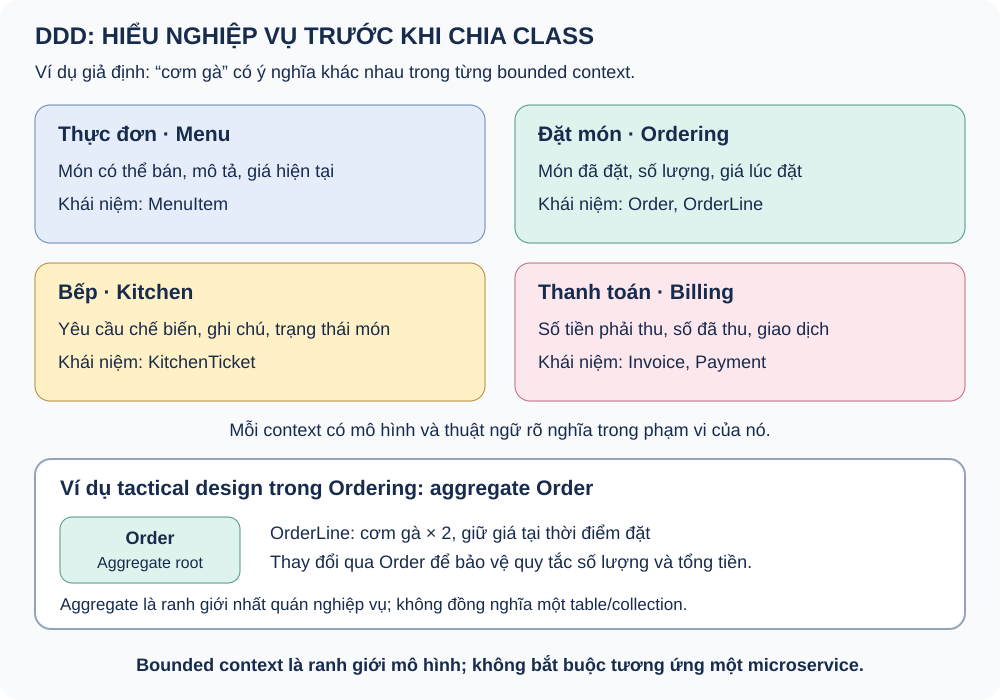

# Domain-Driven Design

Thiết kế phần mềm lấy nghiệp vụ làm trung tâm.

Ví dụ: nhà hàng (Thực đơn, Đặt món, Bếp, Thanh toán).

Note: Ví dụ nhà hàng là minh họa khái niệm; không phải code đã triển khai ở w-identity.

---

## Hai nửa của DDD

Strategic: ngôn ngữ chung, bounded context, subdomain, context map.

Tactical: entity, value object, aggregate, repository, domain service, domain event.

Note: Strategic đi trước. Chọn sai ranh giới thì pattern tactical đẹp cũng mô hình hóa sai bài toán. DDD không phải cách chia folder.

---

## Bounded Context và Subdomain

Bounded context: phạm vi một mô hình và ngôn ngữ nhất quán.

Subdomain: core, supporting, generic. Core đáng đầu tư mô hình sâu; generic nên dùng giải pháp có sẵn.

Note: Subdomain thuộc không gian bài toán, bounded context thuộc không gian giải pháp. Context không bắt buộc là một microservice.

---

## DDD qua nhà hàng

Note: Món trên Menu khác món trong Order, KitchenTicket và Invoice. Nếu giá thực đơn thay đổi không được làm đổi đơn đã xác nhận, Ordering giữ giá lúc đặt. Bounded context không bắt buộc là một microservice; aggregate không mặc định là một table.

---

## Quan hệ giữa các context

Customer–Supplier · Shared Kernel · Conformist · Anticorruption Layer · Open Host Service · Separate Ways.

Note: Ordering là upstream của Kitchen. Billing đặt ACL khi tích hợp cổng thanh toán bên ngoài để mô hình ngoài không nhiễm vào mô hình hóa đơn.

---

## Aggregate

Order là aggregate root, kiểm soát OrderLine và tổng tiền.

Tham chiếu aggregate khác bằng ID. Một transaction thường chỉ sửa một aggregate.

Note: Aggregate là ranh giới nhất quán, không mặc định là một table. Nhất quán giữa các aggregate là eventual consistency, thường qua domain event.

---

## Domain Event và Integration Event

Domain Event: sự kiện nghiệp vụ trong một context (OrderConfirmed).

Integration Event: hợp đồng công bố sang context khác.

Note: Domain event không tự bảo đảm gửi bền vững qua broker; integration event thường dùng outbox và cần ổn định phiên bản.

---

## DDD ở w-identity

Identity là subdomain generic: Keycloak lo phần lớn.

w-identity chỉ dùng tư tưởng DDD nhẹ: tách Domain, đặt tên theo nghiệp vụ, UserAccount khác User. Không có aggregate hay domain event.

Note: Nói rõ phần đã làm và chưa làm. Ví dụ nhà hàng dùng để học aggregate, bounded context, context map; không gán cho code w-identity.
