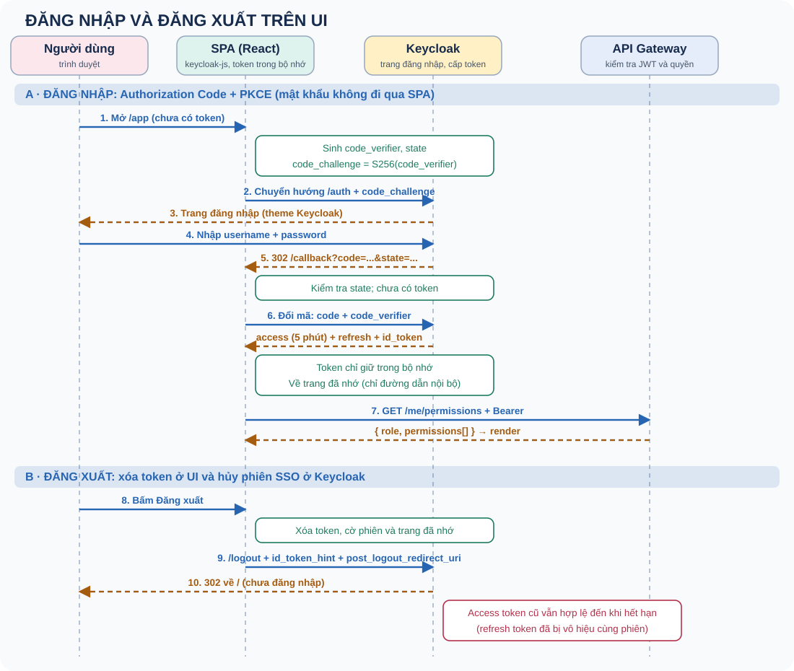
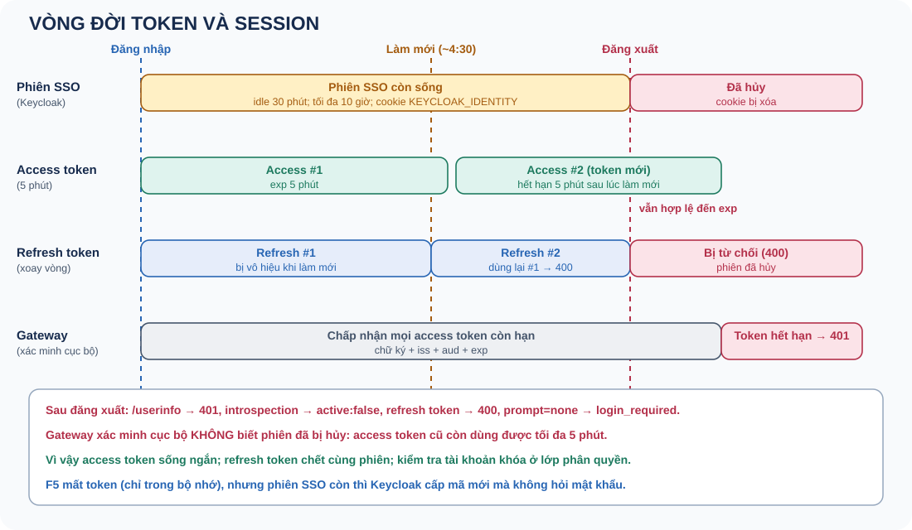

# Keycloak và OIDC — đăng nhập, token, session, đăng xuất

Sổ tay về cách client (SPA) tương tác với Keycloak: đăng nhập, quản lý token, session và đăng xuất. Mọi số liệu và hành vi ở đây được **chạy thật** trên Keycloak 26 ở `localhost:8081` (realm tạm dựng từ `fixtures/pm-realm.json`, đã xóa sau khi thử), không chép từ tài liệu. Phần nối với dự án (gateway, w-identity, UI) nằm ở bài 9, 10 và 11 (bài 11 gom những điều riêng của SPA); phân quyền sau đăng nhập nằm ở sổ tay `#authz`.

Học theo thứ tự 0–11. Mỗi ngày đọc hai chủ đề, tự nói câu trả lời trong 60–90 giây rồi luyện thẻ câu hỏi. Trạng thái 📖 là tài liệu lý thuyết, không khẳng định bạn đã học thuộc.

## Bảng tiến độ

| # | Chủ đề | Bước PLAN | Trạng thái |
|---|---|---|---|
| 0 | OAuth 2.0 và OIDC trong 60 giây | Nền tảng | 📖 |
| 1 | Thành phần và endpoint của Keycloak | Nền tảng | 📖 |
| 2 | Authorization Code + PKCE từng bước | Luồng | 📖 |
| 3 | Ba loại token và các claim | Token | 📖 |
| 4 | Resource server xác minh token | Token | 📖 |
| 5 | Session: SSO session khác token | Session | 📖 |
| 6 | Làm mới token và xoay vòng refresh token | Token | 📖 |
| 7 | Đăng xuất: cái gì mất, cái gì còn | Session | 📖 |
| 8 | Lưu token ở client và các kiểu tấn công | Bảo mật | 📖 |
| 9 | Dự án này: cấu hình và cách chẩn đoán lỗi | Thực hành | 📖 |
| 10 | Cách nói khi phỏng vấn | Thực hành | 📖 |
| 11 | SPA và Keycloak: những điều riêng của ứng dụng trên trình duyệt | Thực hành | 📖 |

## 0. OAuth 2.0 và OIDC trong 60 giây

**OAuth 2.0** là giao thức *ủy quyền*: cho một ứng dụng quyền gọi API thay mặt người dùng mà không đưa mật khẩu. **OpenID Connect (OIDC)** là lớp *xác thực* chạy trên OAuth 2.0: thêm **ID token** để ứng dụng biết người dùng là ai.

Bốn vai trò:

| Vai trò | Trong dự án |
|---|---|
| Resource Owner (người dùng) | Người dùng cuối |
| Client / Relying Party | SPA React (`pm-web`) |
| Authorization Server / OpenID Provider | Keycloak (realm `pm`) |
| Resource Server | API Gateway rồi w-identity |

Ba loại token, mỗi loại cho một người nhận khác nhau:

| Token | Dành cho | Dùng để |
|---|---|---|
| **Access token** | Resource server (gateway) | Chứng minh được phép gọi API |
| **ID token** | Client (SPA) | Cho client biết người dùng là ai |
| **Refresh token** | Keycloak | Lấy access token mới mà không đăng nhập lại |

Điểm cốt lõi: SPA **không bao giờ thấy mật khẩu**. Người dùng nhập mật khẩu trên trang của Keycloak, SPA chỉ nhận lại một mã rồi đổi lấy token.

**Bẫy phỏng vấn:** Nói OAuth 2.0 là giao thức xác thực; dùng access token để biết "user là ai" ở client; dùng ID token để gọi API.

**Tự trả lời:** viết lại bằng lời của bạn, nêu một đánh đổi và một tình huống kiểm thử.

## 1. Thành phần và endpoint của Keycloak

| Khái niệm | Ý nghĩa |
|---|---|
| **Realm** | Một vùng tách biệt gồm user, client, role, cấu hình. Dự án dùng realm `pm` (realm `master` chỉ để quản trị) |
| **Client** | Ứng dụng được phép dùng Keycloak. `pm-web` (public, SPA) và `identity-service` (confidential, có secret, gọi Admin API) |
| **Public client** | Không giữ được secret (SPA, mobile): bảo vệ bằng PKCE |
| **Confidential client** | Giữ được secret (server): xác thực bằng secret |
| **Client scope** | Nhóm claim và mapper gắn vào token. `basic` chứa claim `sub` |
| **Mapper** | Thêm claim vào token, ví dụ Audience mapper thêm `aud = w-identity` |

Tự mô tả qua **discovery document** `/.well-known/openid-configuration`. Các endpoint chính (đã kiểm chứng, tiền tố `/realms/<realm>/protocol/openid-connect`):

| Endpoint | Dùng cho |
|---|---|
| `/auth` (authorization) | Trình duyệt được chuyển tới để đăng nhập |
| `/token` | Đổi mã lấy token; làm mới token |
| `/userinfo` | Lấy thông tin người dùng bằng access token (kiểm tra cả phiên) |
| `/certs` (JWKS) | Khóa công khai để xác minh chữ ký token |
| `/logout` (end session) | Đăng xuất, hủy phiên SSO |
| `/token/introspect` | Hỏi Keycloak token còn hợp lệ không (cần xác thực client) |
| `/revoke` | Thu hồi token |

Discovery cũng cho biết server hỗ trợ `code_challenge_methods: plain, S256` và nhiều grant (kể cả `password`, `implicit`). **Hỗ trợ không có nghĩa là client được dùng**: client `pm-web` chỉ bật Standard flow và ép PKCE `S256`, tắt Direct access grants và Implicit.

**Bẫy phỏng vấn:** Dùng realm `master` cho ứng dụng; bật Implicit hoặc Password cho SPA; nhầm client public với confidential.

**Tự trả lời:** viết lại bằng lời của bạn, nêu một đánh đổi và một tình huống kiểm thử.

## 2. Authorization Code + PKCE từng bước



Các tham số khi chuyển hướng tới `/auth`:

| Tham số | Vai trò |
|---|---|
| `client_id` | Client nào đang xin đăng nhập (`pm-web`) |
| `response_type=code` | Yêu cầu một **mã** (Authorization Code), không phải token |
| `scope=openid ...` | `openid` bật OIDC và cấp ID token |
| `redirect_uri` | Nơi Keycloak trả mã về; phải khớp **chính xác** địa chỉ đã đăng ký |
| `state` | Giá trị ngẫu nhiên để chống CSRF; Keycloak trả lại nguyên vẹn, client phải kiểm tra |
| `nonce` | Gắn vào ID token để chống phát lại; ID token trả về chứa đúng `nonce` đã gửi |
| `code_challenge`, `code_challenge_method=S256` | PKCE: băm SHA-256 của `code_verifier` |

Các bước đã chạy thật:

1. SPA sinh `code_verifier` ngẫu nhiên, tính `code_challenge = BASE64URL(SHA256(code_verifier))`, rồi chuyển hướng tới `/auth`.
2. Keycloak hiện trang đăng nhập; người dùng nhập mật khẩu **trên Keycloak**.
3. Keycloak chuyển hướng về `redirect_uri?code=...&state=...&iss=...`.
4. SPA kiểm tra `state`, gọi `POST /token` với `code` và `code_verifier`, nhận access, id và refresh token.

Những điều đã kiểm chứng:

- Đổi mã bằng `code_verifier` **sai** thì trả `400`.
- `redirect_uri` lạ thì Keycloak trả `400` và không chuyển hướng.
- Mã chỉ dùng được **một lần** và sống ngắn (`accessCodeLifespan` = 60 giây trong realm này).
- Phản hồi chuyển hướng có thêm tham số `iss` (RFC 9207) giúp client phát hiện bị lừa sang máy chủ khác (mix-up attack).

Vì sao cần PKCE: SPA là public client, không giữ được secret. PKCE thay secret bằng một cặp gắn với *lượt đăng nhập này*. Kẻ chặn được mã (ví dụ qua URL) không có `code_verifier` nên không đổi được token.

**Bẫy phỏng vấn:** Dùng luồng Implicit (token nằm trong URL); không kiểm tra `state`; dùng `redirect_uri` có ký tự đại diện; nghĩ PKCE chỉ dành cho mobile.

**Tự trả lời:** viết lại bằng lời của bạn, nêu một đánh đổi và một tình huống kiểm thử.

## 3. Ba loại token và các claim

Phản hồi của `/token` có: `access_token`, `id_token`, `refresh_token`, `expires_in` (300), `refresh_expires_in` (1800), `scope` và `session_state`.

Giải mã thật cho thấy (token là JWT: header.payload.signature; payload chỉ được mã hóa base64url, **không bí mật**):

| Claim | Access token | ID token | Refresh token |
|---|---|---|---|
| `typ` | `Bearer` | `ID` | `Refresh` |
| `aud` (người nhận) | `w-identity` | `pm-web` | URL của realm |
| `azp` (client xin token) | `pm-web` | `pm-web` | |
| `iss` | URL realm | URL realm | URL realm |
| `sid` (mã phiên) | có | có | có |
| Đặc biệt | `scope`, `preferred_username` | `nonce`, `at_hash` | |
| `exp - iat` | 300 giây | | 1800 giây |

Rút ra:

- **Ba token cùng `sid`:** cùng thuộc một phiên Keycloak, nên khi phiên bị hủy, cả ba bị ảnh hưởng (bài 7).
- **`aud` khác nhau là chủ ý.** Access token dành cho API (`w-identity`), ID token dành cho client (`pm-web`). Client không được đưa ID token cho API.
- **`sub`** là định danh ổn định của người dùng. Nó đến từ client scope **`basic`**.

**Bài học thực tế (lỗi của chính dự án này):** fixture ban đầu liệt kê `defaultClientScopes` mà thiếu `basic`, nên access token **không có `sub`**. Gateway yêu cầu `sub` nên sẽ trả 401 cho mọi request dù token hợp lệ. Phát hiện khi giải mã token thật; sửa bằng cách thêm `basic`. Khi tùy biến client scope mặc định, hãy kiểm tra lại claim trong token.

**Bẫy phỏng vấn:** Tin nội dung JWT khi chưa xác minh chữ ký; lưu dữ liệu nhạy cảm trong claim; đưa ID token cho API; không nhận ra `aud` sai là lỗi phổ biến.

**Tự trả lời:** viết lại bằng lời của bạn, nêu một đánh đổi và một tình huống kiểm thử.

## 4. Resource server xác minh token

Gateway (resource server) xác minh JWT **cục bộ**, không gọi Keycloak mỗi request:

1. Lấy khóa công khai từ JWKS (`/certs`), chọn khóa theo `kid` trong header. Realm có khóa ký `RS256` (cho chữ ký) và một khóa mã hóa riêng (`RSA-OAEP`).
2. Kiểm tra **chữ ký** và thuật toán cho phép (`RS256`).
3. Kiểm tra `iss` (đúng realm), `aud` (đúng `w-identity`), `exp` (chưa hết hạn), `typ = Bearer`, và có `sub`, `iat`.
4. Xoay khóa: khi gặp `kid` lạ thì tải lại JWKS (có thời gian chờ giữa các lần để chống lạm dụng).

So sánh hai cách kiểm tra token:

| Cách | Ưu | Nhược |
|---|---|---|
| **Xác minh cục bộ** (chữ ký + claim) | Nhanh, không phụ thuộc Keycloak lúc chạy | Không biết phiên đã bị hủy: token vẫn qua đến khi hết hạn |
| **Introspection** (hỏi Keycloak) | Biết token còn hiệu lực theo phiên ngay | Thêm một lần gọi mạng mỗi lần kiểm tra |

Đã kiểm chứng: `introspect` trả `active: true` khi phiên còn và `active: false` sau khi đăng xuất, trong khi xác minh cục bộ vẫn chấp nhận token đến lúc `exp`. Đây là lý do access token sống ngắn (5 phút) là *chủ ý thiết kế*, và vì sao dự án bổ sung kiểm tra tài khoản bị khóa ở lớp phân quyền (xem `#authz`).

**Bẫy phỏng vấn:** Không kiểm tra `aud` hoặc `iss`; chấp nhận thuật toán `none` hoặc `HS256` từ token; nghĩ xác minh cục bộ biết ngay khi user đăng xuất.

**Tự trả lời:** viết lại bằng lời của bạn, nêu một đánh đổi và một tình huống kiểm thử.

## 5. Session: SSO session khác token

Có **hai thứ khác nhau** hay bị nhầm:

| | Phiên SSO (Keycloak) | Token (client) |
|---|---|---|
| Nằm ở đâu | Keycloak, nhận biết bằng cookie của trình duyệt trên miền Keycloak | Bộ nhớ của SPA |
| Cookie (đã thấy) | `KEYCLOAK_IDENTITY`, `KEYCLOAK_SESSION`, `AUTH_SESSION_ID` | Không có cookie |
| Sống bao lâu | `ssoSessionIdleTimeout` = 1800 giây không hoạt động; tối đa `ssoSessionMaxLifespan` = 36000 giây | `exp` của từng token (5 phút / 30 phút) |
| Dùng để | Đăng nhập lại **không cần nhập mật khẩu** | Gọi API |



Hệ quả:

- **F5 mất token** (token chỉ trong bộ nhớ), nhưng nếu phiên SSO còn thì Keycloak cấp mã mới ngay mà không hỏi mật khẩu.
- `prompt=none` hỏi Keycloak "đã có phiên chưa" mà không hiện trang đăng nhập: chưa có phiên thì trả `error=login_required` (đã kiểm chứng, cả trước khi đăng nhập và sau khi đăng xuất).
- Hai chế độ khi khởi động của keycloak-js: **`check-sso`** (có phiên thì đăng nhập ngầm, không thì ở trạng thái chưa đăng nhập) và **`login-required`** (không có phiên thì chuyển thẳng sang trang đăng nhập). Dự án dùng `login-required`.
- `sid` trong token chính là mã phiên SSO; mọi token của cùng phiên chia sẻ `sid`.

**Bẫy phỏng vấn:** Nghĩ "đăng xuất" là xóa token; nghĩ F5 buộc nhập lại mật khẩu; nhầm thời hạn token với thời hạn phiên.

**Tự trả lời:** viết lại bằng lời của bạn, nêu một đánh đổi và một tình huống kiểm thử.

## 6. Làm mới token và xoay vòng refresh token

Access token sống 5 phút. Để người dùng không phải đăng nhập lại, client dùng refresh token (30 phút trong cấu hình này, bằng `ssoSessionIdleTimeout`):

`POST /token` với `grant_type=refresh_token` → nhận access token mới **và refresh token mới**.

**Xoay vòng (rotation)** đã bật (`revokeRefreshToken = true`, `refreshTokenMaxReuse = 0`). Đã kiểm chứng:

- Làm mới thành công, refresh token mới **khác** token cũ, vẫn cùng `sid`.
- Dùng lại refresh token **cũ** → `400 invalid_grant: Maximum allowed refresh token reuse exceeded`. Nếu kẻ trộm và người dùng cùng dùng một refresh token, một bên sẽ bị chặn, và đó là tín hiệu bị lộ.
- Thu hồi bằng `/revoke` thì làm mới sau đó trả `400`.

Cách client quản lý (keycloak-js):

| Việc | Cách làm |
|---|---|
| Trước mỗi lần gọi API | `updateToken(30)`: làm mới nếu token còn dưới 30 giây |
| Token hết hạn khi đang mở | `onTokenExpired` → `updateToken` |
| Làm mới lỗi (phiên hết) | `onAuthRefreshError` → chuyển lại sang đăng nhập |
| API trả 401 | Ép làm mới (`updateToken(-1)`), thử lại **đúng một lần** |

Lưu ý khi nhiều nơi cùng làm mới: với rotation, hai yêu cầu làm mới song song dùng cùng refresh token sẽ làm một yêu cầu thất bại. Nên gom thành một lần làm mới (single-flight) ở client.

**Bẫy phỏng vấn:** Không xoay vòng refresh token; lưu refresh token lâu dài ở `localStorage`; thử lại 401 vô hạn; làm mới song song không gom.

**Tự trả lời:** viết lại bằng lời của bạn, nêu một đánh đổi và một tình huống kiểm thử.

## 7. Đăng xuất: cái gì mất, cái gì còn

Đăng xuất đúng (RP-initiated logout): xóa token ở client **và** chuyển hướng tới `/logout?id_token_hint=...&post_logout_redirect_uri=...&client_id=pm-web`.

- `id_token_hint`: cho Keycloak biết phiên nào cần đóng; không có thì Keycloak hiện trang hỏi xác nhận.
- `post_logout_redirect_uri` phải được đăng ký trước; địa chỉ lạ bị từ chối (`400`, đã kiểm chứng).

Kết quả đã đo **ngay sau khi đăng xuất**:

| Thứ | Trạng thái sau đăng xuất |
|---|---|
| Cookie SSO (`KEYCLOAK_IDENTITY`, `KEYCLOAK_SESSION`) | Bị xóa |
| `prompt=none` | `error=login_required`; mở `/auth` lại thì hiện trang đăng nhập |
| Refresh token cũ | Không dùng được: `400` |
| `/userinfo` với access token cũ | `401` |
| Introspection access token cũ | `active: false` |
| **Xác minh cục bộ ở gateway** | **Vẫn chấp nhận** đến khi `exp` (tối đa 5 phút) |

Kết luận quan trọng: **đăng xuất không thu hồi access token đã cấp** theo nghĩa các resource server xác minh cục bộ. Giảm thiểu: token sống ngắn; refresh token chết cùng phiên; kiểm tra bổ sung ở lớp phân quyền cho tài khoản bị khóa.

Đăng xuất toàn cục: front-channel logout (trình duyệt nạp trang đăng xuất của từng client) và back-channel logout (Keycloak gọi server của client) giúp các client khác biết phiên đã kết thúc. Fixture bật `frontchannelLogout` cho `pm-web`; dự án hiện chỉ có một client nên chưa dùng back-channel.

**Bẫy phỏng vấn:** Chỉ xóa token ở UI (lần sau Keycloak vẫn đăng nhập ngầm); nói đăng xuất làm access token vô hiệu ngay; không đăng ký `post_logout_redirect_uri`.

**Tự trả lời:** viết lại bằng lời của bạn, nêu một đánh đổi và một tình huống kiểm thử.

## 8. Lưu token ở client và các kiểu tấn công

| Cách lưu | XSS đọc được? | CSRF? | Nhận xét |
|---|---|---|---|
| Bộ nhớ (biến JS) | Khó hơn (chỉ khi script chạy trong cùng trang) | Không (dùng header `Authorization`) | **Dự án dùng**; F5 mất token nên phải hỏi lại SSO |
| `localStorage` / `sessionStorage` | **Dễ** (mọi script cùng origin đọc được) | Không | Tránh cho token |
| Cookie `HttpOnly` | Không đọc được từ JS | **Có** nếu không có biện pháp chống | Cần `SameSite` và token CSRF |

Các tấn công và biện pháp:

| Tấn công | Biện pháp |
|---|---|
| Chặn mã ủy quyền | PKCE (`code_verifier`) và mã dùng một lần, sống ngắn |
| CSRF ở luồng đăng nhập | Tham số `state` được kiểm tra |
| Phát lại ID token | `nonce` |
| Chuyển hướng tới địa chỉ lạ | `redirect_uri` và `post_logout_redirect_uri` khớp chính xác; chỉ chấp nhận đường dẫn nội bộ cho trang quay lại |
| Mix-up (máy chủ lạ) | Kiểm tra `iss` trong phản hồi |
| Token bị lộ | Sống ngắn, xoay vòng refresh token, thu hồi |
| XSS | CSP, không `innerHTML` dữ liệu lạ, token không ở `localStorage` |
| Gửi token tới nơi sai | `aud` đúng; không đưa ID token cho API |

CORS không phải biện pháp bảo mật cho API (nó chỉ bảo vệ *trình duyệt*); API vẫn phải xác minh token.

**Bẫy phỏng vấn:** Lưu token ở `localStorage` vì "tiện"; cho rằng CORS bảo vệ API; quên kiểm tra `state`.

**Tự trả lời:** viết lại bằng lời của bạn, nêu một đánh đổi và một tình huống kiểm thử.

## 9. Dự án này: cấu hình và cách chẩn đoán lỗi

Nơi từng phần nằm:

| Phần | Vị trí |
|---|---|
| Realm `pm`, client `pm-web`, `identity-service`, audience mapper | `apps/w-identity/fixtures/pm-realm.json` |
| Đăng nhập, token, đăng xuất ở UI | `apps/u-project-management/src/auth/AuthProvider.tsx` |
| Gọi API, xử lý 401/403/503 | `apps/u-project-management/src/api/apiClient.ts` |
| Xác minh JWT | `apps/api-gateway/src/gateway/auth/jwt-authenticator.ts` |
| CORS | Lõi gateway (`GATEWAY_CORS_ORIGINS`) |

Cấu hình `pm-web`: client public, chỉ Standard flow, PKCE `S256`, `redirect_uri` chính xác `http://localhost:3001/callback`, access token 5 phút, audience mapper `w-identity`, refresh token xoay vòng.

Bảng chẩn đoán (lỗi thật đã gặp hoặc đã tái hiện):

| Triệu chứng | Nguyên nhân thường gặp | Cách kiểm tra |
|---|---|---|
| Trang Keycloak "Page not found / Realm does not exist" | Realm chưa được import | `curl localhost:8081/realms/pm` trả `Realm does not exist` |
| Keycloak báo redirect_uri không hợp lệ (400) | URL của UI không khớp `redirectUris` | So URL trên thanh địa chỉ với client trong Admin Console |
| Gateway trả 401 dù đã đăng nhập | Token thiếu `sub` (thiếu scope `basic`), sai `aud`, sai `iss` | Giải mã payload token, kiểm tra `sub`, `aud`, `iss`, `typ` |
| Trình duyệt chặn lời gọi API | Thiếu CORS cho origin của UI | Xem console; cấu hình `GATEWAY_CORS_ORIGINS` |
| Đăng nhập lặp vô hạn | Chặn cookie bên thứ ba hoặc lệch `redirect_uri` | Xem tab Network, thử trình duyệt khác |
| 401 sau vài phút | Access token hết hạn và không làm mới được | Kiểm tra `onAuthRefreshError`, thời hạn phiên SSO |

Lệnh giải mã nhanh payload (chỉ để học, không đưa token thật vào công cụ bên ngoài):

```text
echo "<payload base64url>" | base64 -d    # thêm dấu "=" cho đủ độ dài nếu cần
```

**Bẫy phỏng vấn:** Không kiểm tra claim thực tế trong token khi gỡ lỗi; đổ lỗi cho gateway trong khi lỗi nằm ở cấu hình client scope.

**Tự trả lời:** viết lại bằng lời của bạn, nêu một đánh đổi và một tình huống kiểm thử.

## 10. Cách nói khi phỏng vấn

Trạng thái thực tế tại 2026-11-09:

| Phần | Trạng thái |
|---|---|
| Fixture realm, client `pm-web`, audience mapper | Đã làm; đã import vào Keycloak local và kiểm tra bằng realm tạm |
| Đăng nhập Authorization Code + PKCE, làm mới có xoay vòng, đăng xuất, kiểm tra `redirect_uri` | Đã kiểm chứng bằng script trên Keycloak thật |
| UI (React + TypeScript) với keycloak-js | Đã làm; 46 test chạy với Keycloak giả; chưa thử đầu-cuối trên trình duyệt thật |
| Xác minh JWT ở gateway | Đã có từ trước, có test |
| Bài 11 (SPA): mô tả luồng, làm mới token, CORS và chẩn đoán | Dựa trên mã UI và mã nguồn `keycloak-js` 26.2.5; chưa thử đầu-cuối trên trình duyệt thật |
| Back-channel logout, đăng ký/quên mật khẩu, theme tùy biến, BFF | Chưa làm |

### Câu trả lời mẫu 60–90 giây

“SPA không nhận mật khẩu. Nó chuyển hướng sang Keycloak bằng Authorization Code với PKCE: SPA sinh một `code_verifier`, gửi `code_challenge`, Keycloak đăng nhập rồi trả về một mã dùng một lần, SPA đổi mã kèm `code_verifier` lấy access, ID và refresh token. Token chỉ giữ trong bộ nhớ. Access token sống 5 phút và được làm mới bằng refresh token có xoay vòng, dùng lại token cũ sẽ bị từ chối. Gateway xác minh chữ ký, `iss`, `aud`, hạn của JWT cục bộ. Đăng xuất là xóa token ở UI và chuyển hướng tới `/logout` kèm `id_token_hint` để hủy phiên SSO; nhưng access token đã cấp vẫn hợp lệ đến hết hạn nên em để nó sống ngắn. Đánh đổi là xác minh cục bộ nhanh nhưng không biết tức thì phiên đã bị hủy.”

**Bẫy phỏng vấn:** Nói đã chạy đầu-cuối trên môi trường thật khi mới thử bằng script và test; kể thiết kế dự kiến như đã làm.

**Tự trả lời:** vì sao SPA không cần client secret? Sau khi đăng xuất, access token cũ còn dùng được ở đâu và không dùng được ở đâu? Hai request làm mới song song với rotation sẽ xảy ra chuyện gì?

## 11. SPA và Keycloak: những điều riêng của ứng dụng trên trình duyệt

Bài này gom những gì làm SPA khác ứng dụng phía server khi dùng Keycloak. Ví dụ lấy từ `apps/u-project-management` (React, `keycloak-js` 26.2.5). Chỗ nói về hành vi của `keycloak-js` được đọc từ mã nguồn thư viện đã cài; **chưa thử đầu-cuối trên trình duyệt thật**. Hành vi chung của trình duyệt (cookie bên thứ ba, máy chủ tĩnh) là kiến thức phổ biến, không được đo trong dự án.

### 11.1 SPA là gì và vì sao là public client

| Kiểu ứng dụng | Mã chạy ở | Giữ được secret? | Ai đổi mã lấy token | Token nằm ở |
|---|---|---|---|---|
| Render phía server | Server | Có (confidential) | Server | Server (trình duyệt chỉ có cookie phiên) |
| **SPA (dự án)** | Trình duyệt | Không (public) và dùng PKCE | Chính SPA qua `keycloak-js` | Bộ nhớ của trang |
| SPA kèm BFF | Trình duyệt và một server nhỏ | BFF giữ secret | BFF | BFF; trình duyệt chỉ có cookie `HttpOnly` |

Mọi thứ trong bundle JavaScript đều xem được, nên không đặt secret ở đó. `config.ts` chỉ chứa URL Keycloak, realm, client id, URL API; các biến `REACT_APP_*` được nhúng lúc build và là thông tin công khai. BFF (Backend For Frontend) giữ token ngoài tầm với của JavaScript nên an toàn hơn trước XSS, đổi lại phải vận hành thêm một thành phần và phải chống CSRF vì quay về dùng cookie. Dự án chọn SPA thuần cho đơn giản; BFF là hướng nâng cấp, chưa làm.

### 11.2 Một lượt đăng nhập nhìn từ vòng đời trang

1. Người dùng mở `/app/users`. `AuthProvider` ghi đường dẫn này vào `sessionStorage` (khóa `pm.return-to`) rồi gọi `keycloak.init({ onLoad: 'login-required', pkceMethod: 'S256', checkLoginIframe: false, redirectUri: '<origin>/callback' })`.
2. Chưa có phiên: `keycloak-js` sinh `state`, `nonce`, `code_verifier`, ghi trạng thái chờ này (chưa phải token) vào `localStorage` khóa `kc-callback-<state>`, rồi **chuyển hướng cả trang** sang Keycloak. Toàn bộ state JavaScript của SPA biến mất.
3. Keycloak đăng nhập xong và chuyển về `http://localhost:3001/callback#state=…&code=…`. Mặc định `responseMode` là `fragment`: mã nằm sau dấu `#`, trình duyệt không gửi phần này lên server.
4. SPA nạp lại từ đầu. `init` đọc mã từ URL, **xóa nó khỏi thanh địa chỉ** bằng `history.replaceState`, đối chiếu `state` với bản đã lưu (và xóa bản lưu), đổi mã cùng `code_verifier` lấy token rồi giữ token trong bộ nhớ.
5. `CallbackPage` thấy trạng thái `authenticated`, gọi `takeReturnTo()` (đọc rồi xóa `pm.return-to`) và `navigate(…, { replace: true })` về trang đang xem lúc đầu.

F5 là lặp lại từ bước 1: token trong bộ nhớ mất, nhưng cookie phiên SSO của Keycloak còn nên trang chỉ đi–về mà không hỏi lại mật khẩu (bài 5). Bài 8 nói không để *token* ở `localStorage`; còn trạng thái chờ gồm `code_verifier` thì `keycloak-js` ghi tạm ở `localStorage`, dùng một lần và bị xóa khi xử lý callback.

### 11.3 Định tuyến phía client và trang `/callback`

- `/callback` là route của SPA, không phải endpoint server. Máy chủ tĩnh hoặc CDN phải trả `index.html` cho mọi đường dẫn không phải file (*history fallback*); nếu không, bước Keycloak chuyển về sẽ gặp 404. Server dev của Create React App làm sẵn, môi trường thật phải tự cấu hình.
- Ba nơi phải khớp: `redirectUri` trong code (`<origin>/callback`), `redirectUris` của client `pm-web` (`http://localhost:3001/callback`) và danh sách origin của CORS ở gateway. Đổi cổng, domain hay `https` là phải sửa cả Keycloak lẫn gateway.
- Trang quay lại chỉ nhận đường dẫn nội bộ. `safeReturnTo` từ chối `//evil.com`, ký tự `\`, ký tự điều khiển, chuỗi dài hơn 2048 và chính `/callback` (tránh vòng lặp). Giá trị này đi qua storage nên được coi là dữ liệu không tin cậy, nếu không sẽ thành *open redirect*.

### 11.4 Token trong SPA: làm mới và lỗi

| Tình huống | Code trong dự án | Hành vi |
|---|---|---|
| Trước mỗi lời gọi API | `getToken()` gọi `updateToken(30)` | Làm mới nếu token còn dưới 30 giây; lỗi thì ném `SessionExpiredError` |
| Token hết hạn lúc rảnh | `onTokenExpired` | Gọi `updateToken(30)`; lỗi thì `redirectToLogin` (quay lại đúng trang) |
| Gateway trả 401 | `forceRefresh()` gọi `updateToken(-1)` | Ép làm mới, thử lại **đúng một lần**; vẫn 401 thì `onUnauthorized` |
| Gateway trả 403 | `onForbidden` | **Không đăng xuất** (đã xác thực nhưng thiếu quyền); tải lại quyền |
| 502/503/504 hoặc mất mạng | `ApiError.retryable` | Lỗi tạm thời, khác với bị từ chối |
| Phiên SSO bị hủy ở nơi khác | `onAuthLogout`, `onAuthRefreshError` | Chuyển sang đăng nhập lại |

Hai chi tiết đáng nhớ. Thứ nhất, `keycloak-js` 26.2.5 xếp hàng các lời gọi `updateToken` đồng thời: chỉ lời gọi đầu tiên gửi yêu cầu làm mới, các lời gọi còn lại chờ cùng kết quả, nên hai lời gọi song song không làm hỏng nhau khi refresh token được xoay vòng (bài 6). Thứ hai, dự án đặt `checkLoginIframe: false` (mặc định là bật, kiểm tra mỗi 5 giây). Iframe này cần cookie bên thứ ba và thư viện có sẵn đường báo timeout khi không nhận được thông điệp từ nó; trình duyệt chặn cookie bên thứ ba là lý do phổ biến để tắt (lý do chính xác của dự án chưa được ghi lại). Đánh đổi: UI không biết ngay phiên SSO bị hủy ở tab khác, chỉ biết khi lần làm mới kế tiếp thất bại.

### 11.5 Gọi API từ trình duyệt: CORS và Bearer

- SPA ở `http://localhost:3001` gọi gateway `http://localhost:3000`: khác origin nên áp dụng CORS. Header `Authorization` khiến trình duyệt gửi trước một yêu cầu **preflight** `OPTIONS`.
- Gateway (xem README): `GATEWAY_CORS_ORIGINS` liệt kê origin chính xác (không path, không `*`), preflight được trả lời **trước** bước xác thực vì preflight không mang token, origin lạ nhận 403.
- Token đi bằng header `Authorization: Bearer`, không bằng cookie: trình duyệt không tự gắn nó nên không có CSRF kiểu cookie. Đổi lại JavaScript phải tự gắn token, nên XSS nguy hiểm hơn.
- Mỗi yêu cầu có `X-Request-Id` (`crypto.randomUUID()`); gateway trả lại `requestId` trong `problem+json`, dùng để lần theo log qua UI, gateway và service.
- Khi CORS chặn, `fetch` chỉ ném lỗi mạng chung chung và UI không đọc được trạng thái thật; dự án gói nó thành `ApiError` có `status` bằng 0. Chi tiết nằm ở console của trình duyệt ("blocked by CORS policy").

### 11.6 Bảo mật riêng của SPA

| Rủi ro | Vì sao | Biện pháp |
|---|---|---|
| Mã nguồn công khai | Ai cũng đọc được bundle và biến `REACT_APP_*` | Không đặt secret hay khóa riêng ở client |
| XSS | Script chèn vào cùng origin chạy với quyền của ứng dụng: đọc được `keycloak.token` hoặc gọi API thay người dùng. Token trong bộ nhớ chỉ làm khó hơn, không ngăn được | CSP, không chèn HTML từ dữ liệu lạ, kiểm soát phụ thuộc |
| Chuỗi cung ứng npm | Gói độc hại chạy với đúng quyền của ứng dụng | Khóa phiên bản (`package-lock.json`), rà soát khi nâng cấp |
| Phân quyền ở UI | Người dùng sửa được JavaScript hoặc gọi API trực tiếp | Ẩn nút theo `/me/permissions` chỉ để tiện dùng; quyết định thật ở gateway và service (`#authz`) |

### 11.7 Build, môi trường và kiểm thử

- Cấu hình được nhúng lúc build (Create React App chỉ nhúng biến bắt đầu bằng `REACT_APP_`): `REACT_APP_KEYCLOAK_URL`, `REACT_APP_KEYCLOAK_REALM`, `REACT_APP_KEYCLOAK_CLIENT_ID`, `REACT_APP_API_URL`. Đổi môi trường là build lại. Mỗi môi trường cần redirect URI và origin riêng trong Keycloak.
- Cổng dev là 3001 vì 3000 đã dành cho gateway; số này phải khớp client `pm-web` và `GATEWAY_CORS_ORIGINS`.
- `keycloak-js` là gói ESM mà Jest của Create React App không nạp được, nên `createKeycloak.ts` được tách riêng và `AuthProvider` nhận một `KeycloakClient` (`Pick<Keycloak, …>`) để test truyền đối tượng giả. Đánh đổi: test không bắt được lỗi cấu hình thật với Keycloak (redirect URI, scope), nên vẫn cần thử đầu-cuối.

### 11.8 Chẩn đoán lỗi riêng của SPA

| Triệu chứng | Nguyên nhân thường gặp | Cách kiểm tra |
|---|---|---|
| UI báo chung "Không tải được quyền" dù đã đăng nhập (gặp ngày 2026-11-09) | `GET /me/permissions` thất bại: gateway chạy sai project (`GATEWAY_PROJECT=example` nên không có route, gateway trả 404 `ROUTE_NOT_FOUND`), service w-identity chưa chạy, hoặc thiếu CORS | Tab Network: xem status và `code` trong `problem+json`; gọi `curl localhost:3000/me/permissions` không token, kết quả phải là lỗi xác thực chứ không phải `ROUTE_NOT_FOUND` |
| Trang trắng hoặc 404 khi Keycloak chuyển về `/callback` | Máy chủ tĩnh không có history fallback | Mở thẳng `/callback`, xem có trả `index.html` không |
| Đăng nhập lặp vô hạn | `redirectUri` lệch client, hoặc storage bị chặn nên không đọc lại được `kc-callback-…` | Network, và Application → Local Storage |
| F5 bị hỏi lại mật khẩu | Cookie phiên SSO không còn (hết hạn, bị chặn, hoặc đã đăng xuất ở nơi khác) | Bài 5 |
| Dùng được vài phút rồi 401 | Làm mới token thất bại | `onAuthRefreshError`, bài 6 |
| Console có "blocked by CORS policy" | Origin của UI không nằm trong `GATEWAY_CORS_ORIGINS` | So `window.location.origin` với cấu hình gateway |

Bài học từ ca đầu tiên: một thông báo chung ở UI có thể đến từ ba tầng (gateway, service, CORS). Đừng đoán; đọc status và `code` trả về, rồi đi từng tầng.

**Bẫy phỏng vấn:** Nói "SPA an toàn vì token nằm trong bộ nhớ" mà không nhắc XSS vẫn dùng được token; quên rằng `/callback` cần history fallback ở môi trường thật; ẩn nút trên UI rồi coi đó là phân quyền; nhầm response mode `fragment` (mã không gửi lên server) với `query`.

**Tự trả lời:** vì sao SPA không cần secret mà vẫn an toàn khi đổi mã? Sau F5 điều gì còn và điều gì mất? Khi nào bạn chọn BFF thay cho SPA thuần, và phải đánh đổi gì?

## Từ điển nhanh

| Thuật ngữ | Giải thích |
|---|---|
| OAuth 2.0 | Giao thức ủy quyền: cấp quyền gọi API mà không đưa mật khẩu |
| OIDC | Lớp xác thực trên OAuth 2.0, thêm ID token |
| Authorization Server / OP | Máy chủ cấp token (Keycloak) |
| Relying Party / Client | Ứng dụng xin đăng nhập (SPA) |
| Resource Server | API nhận và xác minh access token (gateway) |
| Realm | Vùng tách biệt gồm user, client, cấu hình trong Keycloak |
| Public client | Client không giữ được secret (SPA, mobile) |
| Confidential client | Client giữ được secret (server) |
| Authorization Code | Mã dùng một lần đổi lấy token |
| PKCE | Cơ chế gắn `code_verifier` vào lượt đăng nhập để chặn đánh cắp mã |
| `state` | Giá trị chống CSRF ở luồng đăng nhập |
| `nonce` | Giá trị gắn vào ID token để chống phát lại |
| Access token | Token cho API; sống ngắn |
| ID token | Token cho client biết người dùng là ai |
| Refresh token | Token lấy access token mới; được xoay vòng |
| JWT | Token có chữ ký: header.payload.signature |
| JWKS | Tập khóa công khai để xác minh chữ ký |
| `aud` | Người nhận dự kiến của token |
| `azp` | Client đã xin token |
| `sid` | Mã phiên SSO, dùng chung cho các token của một phiên |
| SSO session | Phiên đăng nhập ở Keycloak, nhận biết bằng cookie |
| `prompt=none` | Hỏi phiên có sẵn mà không hiện trang đăng nhập |
| `check-sso` / `login-required` | Hai chế độ khởi động của keycloak-js |
| Introspection | Hỏi Keycloak token còn hiệu lực không |
| Revocation | Thu hồi token |
| Refresh token rotation | Mỗi lần làm mới cấp refresh token mới, token cũ không dùng lại được |
| RP-initiated logout | Client chuyển hướng tới `/logout` để hủy phiên SSO |
| Front-channel / back-channel logout | Cách báo các client khác khi phiên kết thúc (qua trình duyệt / gọi server) |
| SPA | Ứng dụng một trang: mã chạy ở trình duyệt, điều hướng bằng JavaScript |
| BFF | Server nhỏ đứng giữa trình duyệt và API, giữ token và secret thay cho trình duyệt |
| History fallback | Máy chủ tĩnh trả `index.html` cho mọi đường dẫn của SPA (ví dụ `/callback`) |
| Response mode (`fragment` / `query`) | Mã ủy quyền trả về sau dấu `#` (không gửi lên server) hay trong chuỗi truy vấn |
| Preflight | Yêu cầu `OPTIONS` mà trình duyệt gửi trước khi gọi API khác origin có header đặc biệt |
| Open redirect | Lỗi cho phép chuyển người dùng tới địa chỉ lạ qua tham số quay lại |
| CSP | Chính sách nội dung do server khai báo, giới hạn script được chạy trên trang |

## Nguồn và cách dùng

Thông số lấy từ thí nghiệm trên Keycloak 26 của dự án (thời hạn token, tên cookie, mã lỗi). Đặc tả chuẩn: OAuth 2.0 (RFC 6749), PKCE (RFC 7636), OIDC Core, RFC 9207 (tham số `iss`). Giá trị như 300 giây hay 1800 giây là cấu hình của dự án này, không phải mặc định bắt buộc.
