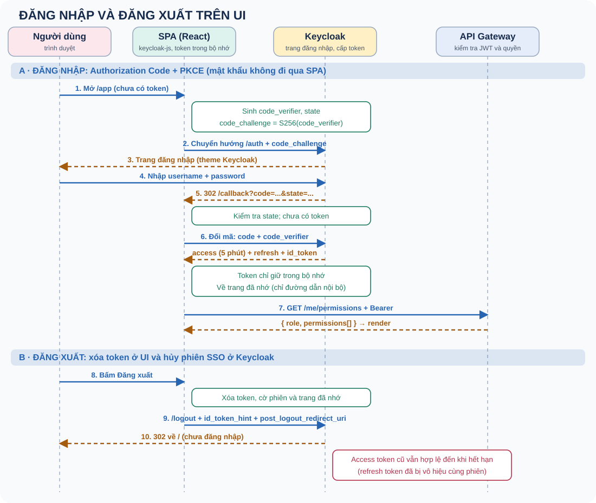
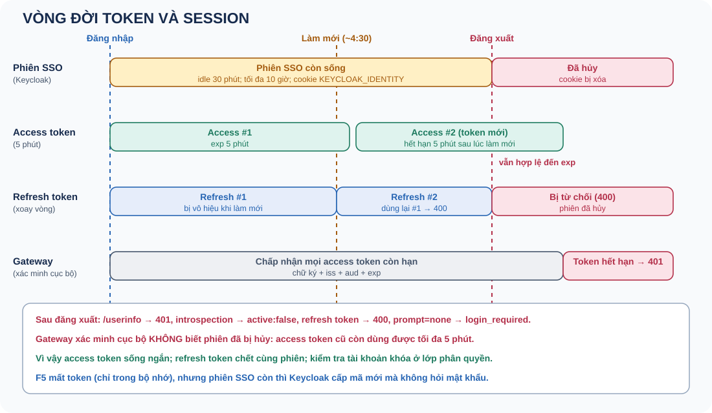

# Keycloak và OIDC

Đăng nhập, token, session và đăng xuất giữa SPA và Keycloak.

Thông số được kiểm chứng trên Keycloak 26 của dự án.

Note: Nói rõ phần đã kiểm chứng bằng script trên Keycloak thật và phần mới có test với Keycloak giả.

---

## OAuth 2.0 và OIDC

OAuth 2.0: ủy quyền. OIDC: xác thực, thêm ID token.

Access token → API. ID token → client. Refresh token → Keycloak.

Note: SPA không bao giờ thấy mật khẩu. aud của access token là w-identity, của ID token là pm-web.

---

## Authorization Code + PKCE

Note: code_verifier sinh ngẫu nhiên, code_challenge = SHA256. Đổi mã sai verifier trả 400. redirect_uri lạ trả 400. state chống CSRF, nonce chống phát lại, iss trong phản hồi chống mix-up.

---

## Các loại token

Access: Bearer, aud w-identity, 5 phút. ID: aud pm-web, có nonce. Refresh: 30 phút, xoay vòng.

Cùng sid cho cả ba token.

Note: JWT chỉ mã hóa base64url, không bí mật. sub đến từ client scope basic: fixture từng thiếu nên token không có sub và gateway trả 401.

---

## Session và vòng đời token

Note: Phiên SSO ở Keycloak (cookie), token ở client. F5 mất token nhưng phiên còn thì không hỏi lại mật khẩu.

---

## Làm mới và xoay vòng

Làm mới trước khi gọi API; 401 thì làm mới và thử lại đúng một lần.

Dùng lại refresh token cũ → 400 invalid_grant.

Note: Làm mới song song với rotation làm một yêu cầu thất bại: gom thành một lần (single-flight).

---

## Đăng xuất

Xóa token ở UI và chuyển hướng tới /logout với id_token_hint.

Sau đó: userinfo 401, introspection inactive, refresh 400. Gateway xác minh cục bộ vẫn nhận token đến khi hết hạn.

Note: Vì vậy access token sống ngắn. Front-channel và back-channel logout giúp các client khác biết phiên đã kết thúc.

---

## Bảo mật phía client

Token trong bộ nhớ, không localStorage. redirect_uri khớp chính xác. CORS không bảo vệ API.

Note: Tấn công và biện pháp: chặn mã (PKCE), CSRF (state), phát lại (nonce), chuyển hướng lạ (redirect_uri), mix-up (iss), XSS (CSP, không localStorage).

---

## SPA nhìn từ vòng đời trang

Chưa có phiên → cả trang chuyển sang Keycloak → quay về /callback#code → đổi mã lấy token trong bộ nhớ.

F5: mất token, còn phiên SSO → đi–về mà không hỏi mật khẩu.

Note: keycloak-js xóa mã khỏi URL bằng history.replaceState và ghi tạm state, nonce, code_verifier vào localStorage (dùng một lần). Production cần history fallback cho /callback; redirectUri, client và CORS phải cùng một origin.

---

## SPA gọi API

401 → làm mới và thử lại đúng một lần. 403 → không đăng xuất. 5xx hoặc mất mạng → lỗi tạm thời.

Authorization Bearer, preflight OPTIONS, origin chính xác ở gateway.

Note: keycloak-js xếp hàng các lời gọi updateToken đồng thời. XSS vẫn dùng được token trong bộ nhớ; BFF là hướng nâng cấp, chưa làm. UI ẩn nút chỉ để tiện dùng, quyết định thật ở gateway và service.
