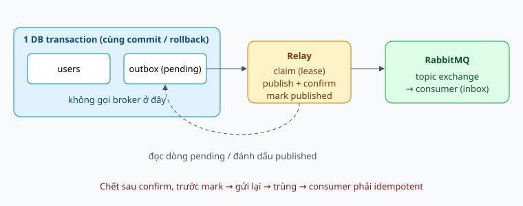

# Transactional Outbox — publish event không mất, không ma

Sổ tay về Transactional Outbox Pattern: vì sao ghi DB rồi publish message là không an toàn, outbox sửa điều đó thế nào, relay hoạt động ra sao, và những gì phải tự lo (trùng lặp, thứ tự, dọn dẹp). Ví dụ dùng MongoDB/Mongoose và RabbitMQ như dự án này. Đây là **tài liệu thiết kế/lý thuyết**: dự án chưa cài outbox, và `@lib-infrastructure/rabbitmq` hiện ghi rõ là "không outbox/deduplication, không exactly-once". Các đoạn code là minh họa, chưa được chạy thử.

Học theo thứ tự 0–9. Mỗi ngày đọc hai chủ đề, tự nói câu trả lời trong 60–90 giây. Trạng thái 📖 là tài liệu lý thuyết, không khẳng định bạn đã học thuộc.

## Bảng tiến độ

| # | Chủ đề | Nhóm | Trạng thái |
|---|---|---|---|
| 0 | Outbox trong 60 giây | Nền tảng | 📖 |
| 1 | Vấn đề dual write | Nền tảng | 📖 |
| 2 | Các lời giải sai và vì sao sai | Nền tảng | 📖 |
| 3 | Cấu trúc outbox và transaction | Cơ chế | 📖 |
| 4 | Relay: polling, claim, publish, đánh dấu | Cơ chế | 📖 |
| 5 | At-least-once và idempotent consumer (inbox) | Độ tin cậy | 📖 |
| 6 | Thứ tự, retry, poison message | Độ tin cậy | 📖 |
| 7 | Polling hay CDC / change stream | Biến thể | 📖 |
| 8 | Vận hành: dọn dẹp, giám sát, nhiều replica | Vận hành | 📖 |
| 9 | Cách nói khi phỏng vấn | Thực hành | 📖 |

## 0. Outbox trong 60 giây

Khi một action vừa **đổi dữ liệu trong DB** vừa **phải thông báo cho service khác qua message broker**, hai việc đó nằm ở hai hệ thống nên không có transaction chung. Một trong hai có thể thành công còn cái kia thất bại.

**Transactional Outbox** giải quyết bằng cách đổi việc "publish" thành việc "ghi một dòng vào DB":

1. Trong **cùng một transaction** với dữ liệu nghiệp vụ, ghi thêm event vào bảng/collection `outbox`.
2. Một tiến trình riêng, **relay**, đọc các dòng chưa gửi trong `outbox`, publish lên broker, rồi đánh dấu đã gửi.

Nhờ bước 1, "đổi dữ liệu" và "có event" cùng thành công hoặc cùng thất bại. Nhờ bước 2, broker down chỉ làm event đến chậm, không làm mất.

Cái giá: event được giao **ít nhất một lần** (có thể trùng), nên consumer phải chịu được trùng.

### Ví dụ đời thường: khay thư đi

Một công ty có thư ký và bưu tá. Mỗi khi ký xong hợp đồng, thư ký cần **ghi vào sổ** và **báo cho khách** bằng thư.

- **Cách dễ hỏng:** thư ký ghi sổ xong rồi tự chạy ra bưu điện. Giữa đường bị ốm thì sổ đã ghi nhưng khách không nhận được thư. Hoặc chạy ra gửi thư trước, quay về thì hợp đồng bị hủy: khách nhận thư về một hợp đồng không tồn tại.
- **Cách outbox:** thư ký ghi sổ **và** bỏ thư vào khay "thư đi" trong cùng một thao tác, không ra khỏi bàn. Bưu tá đi qua định kỳ, lấy thư trong khay mang đi, và chỉ gạch tên thư khỏi khay sau khi bưu điện đóng dấu nhận. Nếu bưu tá ốm, người khác đến lấy tiếp; thư vẫn còn trong khay.

Khay thư chính là bảng `outbox`, bưu tá chính là relay. Điều đáng nhớ: việc "báo cho khách" không còn nằm trong tay người đang ghi sổ.

### Ví dụ xuyên suốt: đặt hàng online

Khách đặt đơn **A1001**, tổng 250.000đ. Khi đặt xong, ba nơi cần biết:

| Nơi nhận | Cần làm gì với event `shop.order.placed` |
|---|---|
| Service Email | Gửi mail xác nhận cho khách |
| Service Giao hàng | Tạo phiếu giao và gọi shipper |
| Activity log | Ghi "khách K gửi đơn A1001 lúc 10:02" |

Ví dụ này dùng lại ở bài 1, 4 và 5.

**Bẫy phỏng vấn:** Nói outbox cho "exactly-once". Không đúng: nó cho at-least-once ở phía publish; exactly-once hiệu dụng chỉ đạt khi consumer idempotent.

**Tự trả lời:** giải thích outbox cho người chưa biết gì, trong ba câu, không dùng từ "pattern".

## 1. Vấn đề dual write

```ts
await users.insertOne(user);          // (1) ghi DB
await rabbit.publish(userCreated);    // (2) publish
```

Hai thao tác này không nguyên tử. Mọi điểm hỏng giữa chúng đều để lại trạng thái sai:

| Điểm hỏng | Trạng thái | Hậu quả |
|---|---|---|
| Process chết sau (1), trước (2) | Có user, không có event | Activity log thiếu, service khác không biết user mới |
| Broker down lúc (2), (1) đã commit | Như trên | Như trên |
| Đảo thứ tự: (2) xong, (1) lỗi/rollback | Có event, không có user | Service khác xử lý một việc **chưa từng xảy ra** |
| Mạng đứt sau khi broker nhận (2) nhưng trước khi client nhận confirm | Client tưởng lỗi, retry | Event trùng |

Hai kiểu hỏng khác nhau về bản chất: **mất event** (thiếu) và **event ma** (thừa). Với audit và activity log, cả hai đều là lỗi nghiêm trọng: audit thiếu thì không chứng minh được ai làm gì, audit thừa thì ghi nhận một hành động không có thật.

Đây là hệ quả của việc không có giao dịch phân tán rẻ và đáng tin giữa DB và broker. Hai-phase commit (XA) về lý thuyết giải quyết được nhưng RabbitMQ và MongoDB không phối hợp được theo cách đó trong thực tế, và nó làm giảm khả dụng.

### Ví dụ thực tế: đơn A1001 gặp sự cố

Dùng cách `await orders.insert(...)` rồi `await rabbit.publish(orderPlaced)`:

| Sự cố | Trạng thái đơn A1001 | Khách và vận hành thấy gì |
|---|---|---|
| Server bị deploy lại ngay sau khi lưu đơn | Đơn có trong DB, trạng thái `placed` | Khách đã trả tiền nhưng **không nhận mail**; kho **không có phiếu giao**; đơn nằm yên cho đến khi khách gọi khiếu nại. Activity log không có dòng nào |
| RabbitMQ đang bảo trì 5 phút | Như trên | Mọi đơn đặt trong 5 phút đó đều thiếu mail và phiếu giao |
| Lập trình viên đổi thứ tự: publish trước, lưu DB sau, và DB lỗi (hết kết nối) | **Không có đơn nào** | Khách nhận mail "đặt hàng thành công", shipper được gọi đến nhà khách, nhưng hệ thống không có đơn để giao hay hoàn tiền |

Dòng 1 và 2 là **mất event**; dòng 3 là **event ma**. Dòng 3 thường tốn kém hơn vì kéo theo hành động ngoài đời (gọi shipper, gửi mail) không thu hồi được.

**Bẫy phỏng vấn:** Cho rằng chỉ cần `try/catch` bao hai dòng là xong. `catch` không chạy khi process bị kill hoặc mất điện giữa hai dòng.

**Tự trả lời:** vẽ lại dòng thời gian của ba kịch bản hỏng và nói mỗi kịch bản để lại trạng thái gì.

## 2. Các lời giải sai và vì sao sai

| Cách làm | Vì sao không đủ |
|---|---|
| Publish **trước**, ghi DB sau | Đổi "mất event" thành "event ma". DB lỗi thì event đã đi rồi, không thu hồi được |
| Publish **sau** commit, bỏ qua lỗi | Mất event khi publish lỗi hoặc process chết |
| Publish sau commit, retry tại chỗ | Retry nằm trong bộ nhớ; process chết thì mất hết |
| Publish **bên trong** transaction (trước commit) | Broker nhận rồi mà commit vẫn có thể thất bại: event ma. Và giữ transaction mở trong lúc gọi mạng làm giảm hiệu năng |
| Consumer tự quét DB của producer | Phá ranh giới service (xem sổ tay `#ddd`: mỗi service sở hữu dữ liệu của nó) |
| Dùng 2PC/XA | Không có hỗ trợ thực tế giữa Mongo và RabbitMQ, cộng thêm vấn đề khả dụng |

Điểm chung của mọi cách sai: **vẫn còn hai thao tác độc lập cần cùng thành công**. Outbox loại bỏ vấn đề tận gốc bằng cách chỉ còn **một** thao tác nguyên tử (một transaction vào một DB) ở đường chính; phần gửi sang broker trở thành việc có thể lặp lại an toàn ở nền.

**Bẫy phỏng vấn:** Đề xuất "publish trước cho chắc". Hậu quả là event ma, thường tệ hơn mất event vì consumer đã hành động.

**Tự trả lời:** chọn một cách sai ở bảng và chỉ ra kịch bản cụ thể làm nó hỏng.

## 3. Cấu trúc outbox và transaction



### Một dòng outbox

```ts
interface OutboxRecord {
  _id: string;            // = event.id (UUIDv7); unique, cũng là khóa idempotency cho consumer
  type: string;           // 'identity.user.created' → routing key
  payload: DomainEvent;   // toàn bộ envelope (xem thiết kế event)
  aggregateId: string;    // để giữ thứ tự theo aggregate
  createdAt: Date;
  status: 'pending' | 'published';
  publishedAt?: Date;
  attempts: number;       // số lần relay đã thử
  lastError?: string;
  lockedUntil?: Date;     // lease của relay đang xử lý (xem bài 4)
}
```

Index cần có: `{ status: 1, createdAt: 1 }` để relay lấy dòng pending theo thứ tự; `{ aggregateId: 1, createdAt: 1 }` nếu cần thứ tự theo aggregate; TTL index trên `publishedAt` để tự dọn.

### Ghi nghiệp vụ và outbox cùng transaction

```ts
await connection.transaction(async (session) => {
  await users.insertOne(user, { session });
  await outbox.insertOne(
    { _id: event.id, type: event.type, payload: event, aggregateId: user.id,
      createdAt: new Date(), status: 'pending', attempts: 0 },
    { session },
  );
});
// Không publish ở đây. Hết transaction là xong phần đồng bộ.
```

Quy tắc: **không gọi broker trong transaction**. Transaction chỉ chứa ghi DB.

### Ràng buộc riêng của MongoDB

- **Transaction đa-document cần replica set** (hoặc sharded cluster). Mongo standalone không có. Môi trường dev dùng `mongod --replSet` một node là đủ.
- Hai collection (`users`, `outbox`) phải **cùng database/cluster** thì mới chung transaction. Đây là lý do outbox là của *từng service* và nằm trong DB của service đó, không phải một outbox dùng chung.
- Phương án thay thế khi không muốn transaction: nhúng event vào **chính document aggregate** (mảng `pendingEvents`) rồi relay lấy ra. Một thao tác ghi đơn document thì nguyên tử sẵn trong Mongo, nhưng bạn phải tự xóa phần tử khỏi mảng và nó làm document phình ra. Hợp với aggregate ít event, kém hợp với audit khối lượng lớn.

**Bẫy phỏng vấn:** Để outbox ở DB khác với dữ liệu nghiệp vụ "cho gọn". Khi đó lại là dual write giữa hai DB.

**Tự trả lời:** vì sao outbox phải cùng DB với dữ liệu nghiệp vụ? Điều gì xảy ra nếu tách?

## 4. Relay: polling, claim, publish, đánh dấu

Relay là vòng lặp nền:

```
loop mỗi ~500ms:
  1. CLAIM    lấy tối đa N dòng pending, gắn lease (lockedUntil = now + 30s)
  2. PUBLISH  gửi từng dòng lên broker, đợi publisher confirm
  3. MARK     đặt status = published, publishedAt = now
  lỗi ở bước 2: tăng attempts, ghi lastError, bỏ lease để thử lại
```

### Claim an toàn khi có nhiều replica

Nếu hai replica của service cùng chạy relay, cả hai có thể đọc cùng dòng và cùng publish → trùng. Claim bằng thao tác nguyên tử:

```ts
const row = await outbox.findOneAndUpdate(
  { status: 'pending', $or: [{ lockedUntil: null }, { lockedUntil: { $lt: new Date() } }] },
  { $set: { lockedUntil: new Date(Date.now() + 30_000) }, $inc: { attempts: 1 } },
  { sort: { createdAt: 1 }, returnDocument: 'after' },
);
```

`findOneAndUpdate` là nguyên tử trên một document nên chỉ một relay nhận được dòng. **Lease** (`lockedUntil`) quan trọng: relay chết giữa chừng thì sau 30 giây dòng tự được nhả cho relay khác, không kẹt vĩnh viễn như khi dùng cờ `processing` không hạn.

### Publish và confirm

Phải **đợi publisher confirm** của broker trước khi đánh dấu `published`. Nếu đánh dấu khi chưa có confirm, broker nhận hụt thì event mất. Lib rabbitmq của dự án đã nói publisher confirm xác nhận broker nhận message, đúng thứ ta cần.

### Khoảng hở còn lại

Publish xong (có confirm) nhưng relay chết **trước** khi đánh dấu → sau khi lease hết, relay khác publish lại → **trùng**. Không thể loại bỏ hoàn toàn khoảng hở này (lại là dual write giữa broker và DB, nhưng lần này an toàn vì lặp lại được). Đây chính là lý do bài 5.

### Ví dụ chạy từng bước: đơn A1001

Dùng id ngắn `evt-0001` cho dễ đọc (thực tế là UUIDv7). Nội dung hai collection theo thời gian:

**t1. Khách đặt đơn, service Đơn hàng chạy một transaction:**

```json
// collection orders
{ "_id": "A1001", "customer": "K", "total": 250000, "status": "placed" }

// collection outbox
{ "_id": "evt-0001", "type": "shop.order.placed", "aggregateId": "A1001",
  "status": "pending", "attempts": 0, "lockedUntil": null,
  "payload": { "orderId": "A1001", "total": 250000 } }
```

Server trả `201 Created` cho khách ngay tại đây. Khách không phải đợi mail hay shipper.

**t2. Relay claim (sau ~500ms):** dòng outbox thành `attempts: 1`, `lockedUntil: now + 30s`.

**t3. Relay publish** `shop.order.placed` lên topic exchange, **đợi confirm** từ RabbitMQ.

**t4. Relay đánh dấu:** `status: "published"`, `publishedAt: ...`. Một tuần sau TTL index tự xóa dòng này.

**t5. Ba consumer nhận event:** Email gửi mail, Giao hàng tạo phiếu, Activity log ghi dòng.

**Kịch bản lỗi: relay chết ở giữa t3 và t4.** RabbitMQ đã nhận event nhưng dòng outbox vẫn `pending` với `lockedUntil` còn hạn.

- Sau 30 giây, lease hết. Relay của replica khác claim lại (`attempts: 2`) và publish **lần hai**.
- RabbitMQ giờ có hai bản `evt-0001`. Đây chính là trùng.
- Nếu Email consumer không phòng bị, khách nhận **hai mail xác nhận**. Bài 5 nói cách chặn.

So sánh với cách publish thẳng: cùng sự cố "chết giữa chừng" chỉ cho **một** kết cục tệ (mất mail và phiếu giao, không ai biết); còn outbox cho kết cục nhẹ hơn (trùng, xử lý được).

**Bẫy phỏng vấn:** Đánh dấu `published` trước khi gửi "để tránh gửi hai lần". Process chết giữa hai bước thì event mất vĩnh viễn: tệ hơn trùng.

**Tự trả lời:** liệt kê các điểm relay có thể chết và nói mỗi điểm dẫn tới mất, trùng, hay không sao.

## 5. At-least-once và idempotent consumer (inbox)

Outbox cho **at-least-once**: mỗi event đến broker ít nhất một lần, có thể nhiều hơn. Chọn at-least-once thay vì at-most-once là cố ý: với audit, trùng sửa được còn mất thì không.

Hệ quả bắt buộc: **consumer phải idempotent**, nghĩa là xử lý cùng event hai lần cho kết quả như một lần.

Ba cách, từ rẻ đến chắc:

| Cách | Mô tả | Dùng khi |
|---|---|---|
| Thao tác tự nhiên idempotent | `upsert` theo khóa, `set` thay vì `increment` | Luôn ưu tiên nếu được |
| **Inbox / bảng đã xử lý** | Lưu `event.id` đã xử lý với unique index; trùng thì bỏ qua | Hiệu ứng không tự idempotent (gửi mail, trừ tiền) |
| Version / optimistic concurrency | So `event.version` hoặc số thứ tự của aggregate với trạng thái hiện có | Cập nhật bản sao dữ liệu |

### Inbox pattern (đối xứng với outbox)

```ts
await connection.transaction(async (session) => {
  try {
    await inbox.insertOne({ _id: event.id, handledAt: new Date() }, { session });
  } catch (e) {
    if (isDuplicateKey(e)) return;   // đã xử lý, bỏ qua
    throw e;
  }
  await applyEffect(event, session); // hiệu ứng và dấu "đã xử lý" cùng transaction
});
```

Dấu "đã xử lý" và hiệu ứng phải **cùng transaction**, nếu không lại có khoảng hở giống bài 1.

Với **activity log** cụ thể, idempotency rất rẻ: dùng `event.id` làm `_id` của bản ghi log. Ghi lại lần hai bị unique index từ chối, và ta coi đó là thành công.

### Ví dụ: ba consumer của đơn A1001 xử lý bản trùng

Event `evt-0001` đến **hai lần**. Mỗi consumer có hậu quả khác nhau nên cách phòng bị cũng khác:

| Consumer | Nếu không phòng bị | Cách chặn |
|---|---|---|
| Giao hàng | Tạo hai phiếu giao cho một đơn | Dùng `upsert` theo `orderId = A1001`: ghi lần hai không tạo bản mới. Tự idempotent, không cần inbox |
| Activity log | Hai dòng log giống nhau | Dùng `event.id` làm `_id` của bản ghi: lần hai bị unique index từ chối, coi như xong |
| Email | **Khách nhận hai mail** (gửi mail không thể "upsert") | **Inbox**: trong một transaction, chèn `evt-0001` vào bảng `inbox` rồi mới gửi. Lần hai chèn trùng khóa nên bỏ qua |

Chú ý thứ tự ở Email: nếu gửi mail trước rồi mới ghi inbox, process chết giữa hai bước làm lần sau gửi lại mail. Nếu ghi inbox trước rồi mới gửi mà chết giữa chừng thì lại **không bao giờ gửi mail**. Với hiệu ứng ra ngoài hệ thống như mail, không có cách chắc chắn tuyệt đối; thực tế người ta chấp nhận "hiếm khi trùng" hơn là "hiếm khi mất", và gửi kèm mã đơn để khách hiểu mail lặp lại.

**Bẫy phỏng vấn:** Hứa "exactly-once delivery". Hệ phân tán không có điều đó; cái đạt được là *effectively-once processing* = at-least-once + idempotent.

**Tự trả lời:** worker activity log nhận event trùng thì điều gì xảy ra, và cần thêm gì để nó vẫn đúng?

## 6. Thứ tự, retry, poison message

### Thứ tự

- Outbox lưu theo `createdAt`, nhưng thứ tự **đến consumer** chỉ được đảm bảo nếu một relay xử lý tuần tự và broker giữ thứ tự. Nhiều relay song song, retry, hoặc nhiều consumer đều làm xáo trộn.
- Thứ tự toàn cục hiếm khi cần. Thứ tự **theo aggregate** (mọi event của user 123 theo đúng trình tự) mới là nhu cầu thật.
- Cách thực tế: consumer không tin thứ tự mà dùng `version`/`occurredAt` của aggregate để bỏ qua event cũ hơn trạng thái hiện có, hoặc event mang đủ dữ liệu để xử lý độc lập.
- Nếu buộc phải giữ thứ tự theo aggregate ở relay: chỉ claim dòng *đầu tiên* chưa gửi của mỗi `aggregateId`, và không gửi dòng sau khi dòng trước còn pending/lỗi.

### Retry

- Dòng lỗi ở bước publish được thử lại ở vòng sau với **backoff** (`attempts` tăng thì `nextAttemptAt` lùi xa dần), tránh dồn dập khi broker đang sập.
- Lỗi tạm thời (broker down) thì thử vô hạn; lỗi vĩnh viễn thì không.

### Poison message

Một dòng luôn thất bại (payload không serialize được, routing key sai) sẽ bị thử mãi và, nếu giữ thứ tự, **chặn cả hàng**. Cách xử lý: sau `maxAttempts`, chuyển `status = 'failed'`, ghi `lastError`, bắn cảnh báo, và để người xử lý thủ công. Tuyệt đối không xóa im lặng.

Lưu ý khác: lỗi ở **consumer** (handler ném exception) không phải việc của outbox. Đó là việc của ack/nack và DLQ của lib rabbitmq. Outbox chỉ bảo đảm event *đến được broker*.

**Bẫy phỏng vấn:** Nghĩ outbox đảm bảo consumer xử lý thành công. Nó chỉ đảm bảo event được *giao cho broker*.

**Tự trả lời:** phân biệt ba nơi có thể thất bại: ghi outbox, relay publish, consumer xử lý. Mỗi nơi do cơ chế nào bảo vệ?

## 7. Polling hay CDC / change stream

Có hai cách để relay biết có dòng mới.

| | Polling | CDC / change stream |
|---|---|---|
| Cách hoạt động | Truy vấn định kỳ `status = pending` | Đăng ký nghe thay đổi của collection (Mongo change stream, Debezium đọc oplog/WAL) |
| Độ trễ | Bằng chu kỳ poll (vài trăm ms đến vài giây) | Gần như tức thời |
| Độ phức tạp | Thấp: một vòng lặp và một index | Cao hơn: cần resume token, xử lý đứt kết nối, replica set |
| Tải DB | Truy vấn đều đặn kể cả khi rỗng | Thấp khi rỗng |
| Cần thêm hạ tầng | Không | Mongo change stream: không (chỉ cần replica set); Debezium: có |
| Thứ tự | Tự đảm bảo bằng sort | Theo thứ tự oplog |

**Khuyến nghị cho dự án học tập này:** bắt đầu bằng **polling**. Đơn giản, dễ test, dễ hiểu, và Mongo transaction đã đòi replica set rồi nên sau này nâng lên change stream không cần thêm hạ tầng. Chỉ chuyển khi độ trễ hoặc tải truy vấn trở thành vấn đề đo được.

Có thể kết hợp: dùng change stream làm *tín hiệu đánh thức* relay, còn polling vẫn chạy chậm làm lưới an toàn phòng khi bỏ lỡ tín hiệu.

**Bẫy phỏng vấn:** Nói CDC "tốt hơn" polling một cách tuyệt đối. Nó đổi độ trễ lấy độ phức tạp vận hành.

**Tự trả lời:** với lưu lượng 5 event/giây và yêu cầu trễ dưới 2 giây, bạn chọn gì và vì sao?

## 8. Vận hành: dọn dẹp, giám sát, nhiều replica

### Dọn dẹp

Outbox chỉ tăng. Nếu không dọn, collection phình và index chậm. Hai cách: TTL index trên `publishedAt` (ví dụ giữ 7 ngày để còn điều tra), hoặc job xóa định kỳ. **Chỉ xóa dòng `published`**; dòng `pending`/`failed` giữ lại.

Lưu ý: outbox **không phải nơi lưu audit lâu dài**. Nơi lưu lâu dài là collection của worker activity log, nơi event được ghi bền vững sau khi tới.

### Giám sát

| Chỉ số | Ý nghĩa | Báo động khi |
|---|---|---|
| Số dòng `pending` | Hàng đợi chưa gửi | Tăng liên tục |
| Tuổi dòng pending cũ nhất | Độ trễ thật của relay | Vượt ngưỡng (vd 30s) |
| Số dòng `failed` | Poison message | Khác 0 |
| `attempts` cao | Broker chập chờn | Nhiều dòng > 5 |

### Nhiều replica

Relay chạy trong mọi replica được: claim bằng `findOneAndUpdate` (bài 4) khiến chúng không giẫm nhau. Đổi lại thứ tự không còn được bảo đảm theo thời gian. Nếu cần thứ tự nghiêm, chạy **một** relay (leader election hoặc một instance riêng) hoặc dùng cách "một dòng đầu mỗi aggregate".

### Kiểm thử

Các kịch bản đáng viết test: crash giữa ghi và publish (event vẫn còn trong outbox); broker down rồi lên lại (event được gửi sau); hai relay cùng chạy (không trùng ở trạng thái bình thường); relay chết sau publish trước mark (trùng, consumer chịu được); rollback transaction (không có dòng outbox).

**Bẫy phỏng vấn:** Quên dọn dẹp rồi ngạc nhiên khi collection vài chục triệu dòng làm relay chậm.

**Tự trả lời:** chỉ số nào cho bạn biết relay đang hỏng mà không cần đọc log?

## 9. Cách nói khi phỏng vấn

Khung trả lời 90 giây:

1. **Vấn đề:** ghi DB và publish message là hai hệ thống nên không nguyên tử; hỏng giữa chừng thì mất event hoặc có event ma.
2. **Giải pháp:** ghi event vào bảng outbox cùng transaction với dữ liệu; relay riêng đọc outbox và publish, đánh dấu sau khi broker confirm.
3. **Đánh đổi:** at-least-once nên consumer phải idempotent (inbox hoặc khóa tự nhiên); thêm độ trễ nhỏ; thêm một relay và việc dọn dẹp.
4. **Biến thể:** polling cho đơn giản, CDC cho độ trễ thấp.
5. **Liên hệ thực tế:** nói rõ phần nào bạn đã làm, phần nào là thiết kế.

Câu hỏi thường gặp và ý chính:

| Câu hỏi | Ý chính |
|---|---|
| Outbox khác gì "publish rồi retry"? | Retry trong bộ nhớ mất khi process chết; outbox bền vì nằm trong DB cùng transaction |
| Có exactly-once không? | Không; at-least-once cộng idempotent consumer cho effectively-once |
| Relay chết giữa chừng thì sao? | Lease hết hạn, relay khác nhận lại; có thể trùng, consumer chịu được |
| Sao không dùng 2PC? | Không có hỗ trợ thực tế, giảm khả dụng, coupling chặt |
| Thứ tự được đảm bảo không? | Chỉ theo aggregate và chỉ khi thiết kế cho nó; đừng giả định thứ tự toàn cục |
| Khi nào không cần outbox? | Mất thi thoảng một event chấp nhận được (thông báo không quan trọng) |
| Outbox khác event sourcing? | Outbox là kênh gửi tin đáng tin; event sourcing dùng chuỗi event làm nguồn sự thật của trạng thái |

**Bẫy phỏng vấn:** Trả lời tuôn tên công cụ (Debezium, Kafka Connect) mà không giải thích được vấn đề cốt lõi là dual write.

**Tự trả lời:** nói lại khung 90 giây bằng lời của bạn, thu âm, rồi nghe xem có bước nào bạn bỏ sót.

## Từ điển nhanh

| Thuật ngữ | Giải thích |
|---|---|
| Dual write | Ghi vào hai hệ thống độc lập (DB và broker) mà không có transaction chung |
| Transactional Outbox | Ghi event vào bảng outbox cùng transaction với dữ liệu, rồi gửi sau |
| Relay / Message relay | Tiến trình nền đọc outbox và publish lên broker |
| Lease | Khóa có hạn gắn vào dòng đang xử lý; hết hạn thì relay khác nhận lại |
| Publisher confirm | Xác nhận của broker rằng đã nhận message |
| At-least-once | Mỗi event đến ít nhất một lần, có thể trùng |
| Idempotent | Xử lý nhiều lần cho kết quả như một lần |
| Inbox | Bảng lưu `event.id` đã xử lý để consumer bỏ qua event trùng |
| Effectively-once | At-least-once cộng idempotent consumer |
| CDC / Change stream | Nghe thay đổi của DB thay vì truy vấn định kỳ |
| Poison message | Dòng luôn thất bại, có thể chặn hàng đợi |
| DLQ | Hàng đợi chứa message xử lý thất bại ở phía consumer |
| Event ma | Event được gửi cho một việc chưa từng commit |
