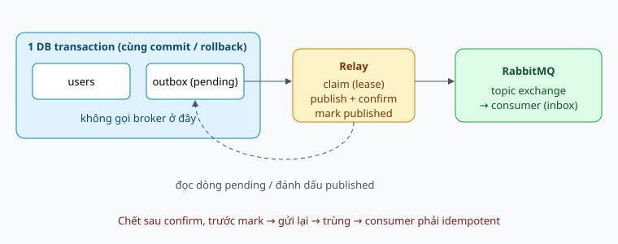

# Transactional Outbox

Publish event đáng tin từ một service dùng MongoDB và RabbitMQ.

Tài liệu thiết kế, chưa triển khai trong dự án.

Note: Nói rõ đây là thiết kế; lib rabbitmq hiện chưa có outbox hay dedup.

---

## Vấn đề: dual write

Ghi DB rồi publish là hai hệ thống, không nguyên tử.

Hỏng giữa chừng: mất event hoặc event ma.

Note: process chết giữa hai dòng thì try/catch không chạy. Audit thiếu hoặc thừa đều nghiêm trọng.

---

## Ý tưởng

Note: Một transaction ghi dữ liệu và dòng outbox. Relay lo phần gửi, lặp lại được.

---

## Relay

Claim bằng lease, publish, đợi confirm, rồi mới mark.

Chết sau publish trước mark: gửi lại.

Note: Chọn trùng thay vì mất. findOneAndUpdate nguyên tử để nhiều replica không giẫm nhau.

---

## At-least-once

Không có exactly-once; có effectively-once.

Consumer idempotent: event.id làm khóa, inbox cùng transaction.

Note: Activity log dùng event.id làm _id nên ghi lần hai bị từ chối là xong.

---

## Thứ tự và lỗi

Chỉ có thứ tự theo aggregate, và phải thiết kế cho nó.

Poison message: failed + cảnh báo, không xóa im lặng.

Note: Lỗi consumer là việc của ack/nack và DLQ, không phải của outbox.

---

## Polling hay change stream

Bắt đầu bằng polling; nâng cấp khi đo được vấn đề.

Note: Mongo transaction đã cần replica set nên change stream không cần thêm hạ tầng.

---

## Vận hành

Dọn dòng published, giám sát pending/tuổi/failed, quyết định số relay.

Note: Outbox không phải nơi lưu audit lâu dài; collection activity log mới là nơi đó.
